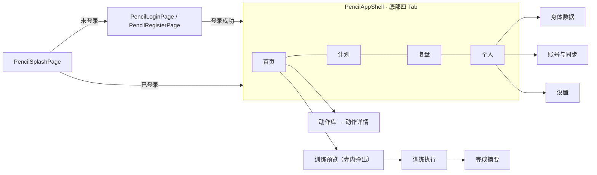

# FitTracker

HarmonyOS 上**本地优先**的健身训练记录应用（ArkTS / ArkUI · Stage 模型）。

记录训练组数、次数与重量，按 Epley 公式估算 1RM，并管理训练目标、计划、训练会话、复盘统计与本地备份数据。数据默认只保存在设备本机；登录后可选择云同步（华为端云一体化 AGC：认证服务 + 云数据库整包快照），跨设备恢复数据。

| 项 | 值 |
| --- | --- |
| 应用身份 | `com.earthrhythm.fittracker`（vendor `EarthRhythm`） |
| 当前版本 | `1.0.0`（`versionCode 1000000`）；「云端账号与同步」（1.1.0）开发中，见 `docs\CHANGELOG.md` |
| 主路由 | `entry\src\main\resources\base\profile\main_pages.json` 注册的 18 个页面 |
| 目标设备 | `phone` |

## 功能

- **训练流**：训练预览 → 训练执行（组次录入、组间计时）→ 完成摘要
- **训练计划**：按分化数成套的预置计划组（如「三分化」），可启用并落库；首页直接呈现「今日训练」
- **训练复盘**：历史训练、周趋势、动作 PR 下钻、肌肉分布与进阶洞察
- **动作库**：动作列表、筛选、收藏与动作详情（含要点与内置 GIF 素材）
- **身体数据**：体重、体脂等记录
- **账号与云同步**：AGC 认证（手机验证码 / 邮箱 / 华为账号）+ 云数据库整包快照（本地优先：离线可写、联网同步）；未配置 AGC 时自动降级为沙盒演示模式
- **启动分流**：冷启动按登录态分流（未登录 → 登录页；已登录 → 主壳）
- **数据备份与恢复**：本地 JSON 导出 / 导入，并承接系统备份回调
- **设置**：单位、语言、周开始日与各项开关状态
- **视觉主线**：按 Open Design 原型还原的深色翠绿（Cool Emerald）界面

## 技术栈

| 项 | 值 |
| --- | --- |
| 语言 / UI | ArkTS、ArkUI 声明式 UI（strict mode，无 `any` / 解构 / 函数表达式） |
| 应用模型 | HarmonyOS Stage，单 `entry` 模块 |
| SDK | HarmonyOS `6.0.2(22)`（compatible 与 target 一致） |
| 数据层 | `@kit.ArkData` preferences + 仓库 / 内存仓库组合（本地优先）；云同步走 `@hw-agconnect/auth` + `@kit.CloudFoundationKit`（AGC） |
| 测试 | `@ohos/hypium` 1.0.25、`@ohos/hamock` 1.0.0（`entry/src/ohosTest`） |
| 构建 | DevEco Studio + DevEco CLI（`devecocli`） |

## 快速开始

前置：DevEco Studio（含 HarmonyOS SDK 6.0.2）已安装，`devecocli` 在 PATH 中。

```bash
# 构建 debug HAP
devecocli build --modules entry@default --product default

# 构建测试 HAP（ohosTest）
devecocli build --modules entry@ohosTest --product default
```

产物：

- `entry\build\default\outputs\default\entry-default-signed.hap`、`entry-default-unsigned.hap`
- `entry\build\default\outputs\ohosTest\entry-ohosTest-signed.hap`、`entry-ohosTest-unsigned.hap`

安装到真机或模拟器（`hdc` 已连接目标设备）：

```bash
hdc install -r entry/build/default/outputs/default/entry-default-signed.hap
```

签名材料存放在工作区外（`~\.ohos\config\`），由 `build-profile.json5` 的 `app.signingConfigs` 引用，不入库。云同步功能需在 `AppScope/resources/rawfile/` 放入 AGC 配置（`agconnect-services.json`，不入库）方可用真实云端；缺失时自动走沙盒。

## 质量门禁

提交前自检：

| 命令 | 作用 |
| --- | --- |
| `node tools/check-gates.mjs` | 总门禁：内容构建 → 页面注册 → 空白检查 → 文档死链 → ArkTS 真实编译（`--skip-build` 可跳过编译，仅在已知编译状态时用） |
| `node tools/check-main-pages.mjs` | 校验 `main_pages.json` 中 18 个页面文件存在，且每页仅一个 `@Entry` |
| `node tools/check-dead-refs.mjs` | 校验文档 / 配置里的仓库内路径断言是否仍成立 |
| `node tools/check-release-readiness.mjs` | release 前置条件：build mode、签名材料、应用身份、产物、材料未入库 |
| `node --test tools/check-release-readiness.test.mjs` | 上述 readiness 脚本的回归测试 |
| `node tools/content/build-content.mjs` | 校验并构建 `content/exercises/*.jsonl` 内容源 |

## 测试

- **单元测试（Hypium，需设备）**：`powershell -ExecutionPolicy Bypass -File tools/ohos-test.ps1`。可选 `-ClassNames <类名>` 或 `-Preset backup|content-sync|full` 过滤，`-CheckOnly` 只校验前置条件；结果写入 `test_run\ohosTest\<时间戳>\ohos-test-summary.md`。已装 signed HAP 的设备需显式传 `-DefaultHapPath` / `-TestHapPath` 指向 signed 产物。
- **设备流程 smoke**：`tools\auth-regression.ps1`（认证回归）、`tools\dev-smoke.ps1`（Midscene 入口冒烟，需先在会话中设置 `MIDSCENE_MODEL_API_KEY`）。
- **原型 / 视觉对比**：`tools\visual-diff\compare.py`（原型帧 vs 设备截图）、`tools\spec-bounds-diff.py`（CSS 声明值 vs 设备 bounds）、`tools\scroll-assert.py`（滚动断言）、`tools\probe-css-metrics.py`（headless Chrome 读计算样式）。

## 目录结构

```text
FitTracker/
├── AppScope/                     应用级配置与资源（bundleName / 版本 / 图标 / 名称 / AGC 配置与 schema.json）
├── entry/
│   ├── src/main/ets/
│   │   ├── app/                  启动、路由常量（AppRoutes.ets）、应用壳（PencilAppShell）
│   │   ├── features/             pencil（视觉主线）/ welcome / account / exercise / body / settings / workout
│   │   ├── shared/               跨功能服务：内容目录、计划引擎、复盘、备份、云同步、内存仓库
│   │   ├── common/               认证（AGC/沙盒）、会话、云环境探测、计划 / 训练持久化、设计令牌（styles\DesignTokens.ets）
│   │   ├── components/           可复用 ArkUI 组件
│   │   ├── generated/ · mock/    内容同步包类型、开发用种子数据
│   │   └── entryability/         EntryAbility 与系统备份扩展
│   ├── src/main/resources/       资源：rawfile 内置动作 GIF / SVG、字符串、颜色
│   └── src/ohosTest/ets/test/    Hypium 单元测试（42 个文件）
├── content/exercises/            动作内容源（JSONL + 同步 manifest）
├── design/                       设计基线：brief / 设计系统 / 组件与页面规格 / 原型重绘
├── docs/                         文档：PRD、发布 runbook、验收与合规
├── tools/                        构建、校验、视觉对比与设备回归脚本
└── AGENTS.md                     工程约束（改动代码前必读）
```

## 主路由



页面注册唯一事实来源是 `entry\src\main\resources\base\profile\main_pages.json`，代码中的路由常量来自 `entry\src\main\ets\app\AppRoutes.ets`；新页面必须同时满足「文件存在 + 已注册 + 被引用」三项。

## 文档导航

| 文档 | 内容 |
| --- | --- |
| `AGENTS.md` | 工程约束：页面注册、服务归属、ArkTS / ArkUI 约定、清理规则、构建命令 |
| `docs\README.md` | 文档入口与实现依据索引 |
| `docs\release-build-runbook.md` | 构建 / 发布工程面的状态、命令与接入点 |
| `docs\cloud-setup.md` | AGC 云服务配置手册（认证服务 / 云数据库 / 证书指纹；配置记录 + 排错速查） |
| `docs\CHANGELOG.md` | 版本说明与更新日志 |
| `docs\mvp-closeout.md` | MVP 功能收官记录 |
| `docs\legal\privacy-policy.md`、`docs\legal\user-agreement.md` | 隐私政策与用户协议 |
| `design\README.md` | 设计基线与阅读顺序（brief → 设计系统 → 组件 → 页面规格） |

## 现状与限制

- **云同步依赖 AGC 配置**：真实账号与云同步需工程内放入 AGC 配置文件（`AppScope/resources/rawfile/`）并完成 AGC 控制台配置（见 `docs\cloud-setup.md`）；未配置时自动降级为沙盒演示模式（数据仅在本机，云端用本地沙盒模拟）。微信 / QQ 登录未开通（需开放平台资质与 SDK 支持评估），华为账号登录待真机验证。
- **「匿名使用数据」「健康数据授权」开关仍仅记录状态**：未接入统计服务或健康数据权限。
- **界面仅提供简体中文**：设置页的「English」选项目前只记录选择状态；`zh_CN` / `en_US` 资源目录已就绪，界面文案仍为代码内中文。
- **仅支持 `phone` 设备类型**（`entry\src\main\module.json5`）。
- **`bundleName` 决定应用私有沙箱路径**：由样板值改为 `com.earthrhythm.fittracker` 后，旧身份包留下的本地数据在新包下不可见，升级前请先导出备份包（迁移路径见 `docs\release-build-runbook.md` 第 9 节）。

「界面仅提供简体中文」为 `1.0.0` 起的既有限制，版本更新记录见 `docs\CHANGELOG.md`。

## 开发约定（摘要）

- 页面统一放 `features/<feature>/pages/`，无 `@Entry` 的界面体放 `features/<feature>/components/`；不要复活已移除的历史壳与旧路由。
- 服务使用模块级 singleton（`export default new ServiceName()`），调用方直接导入默认实例。
- 导航走 `this.getUIContext().getRouter()`，路由名只引用 `AppRoutes` 常量。
- 颜色 / 字体 / 间距优先取 `common\styles\DesignTokens.ets`，避免组件内散落魔法值。
- 用户可见文本使用中文；新能力需确认有生产调用方。

完整约束见 `AGENTS.md`。

## 许可

本仓库当前未包含开源许可文件。
