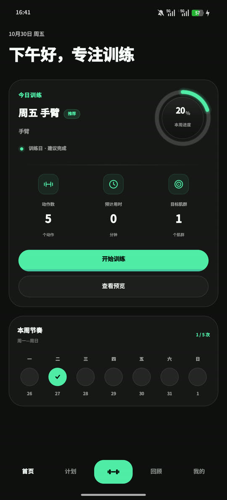
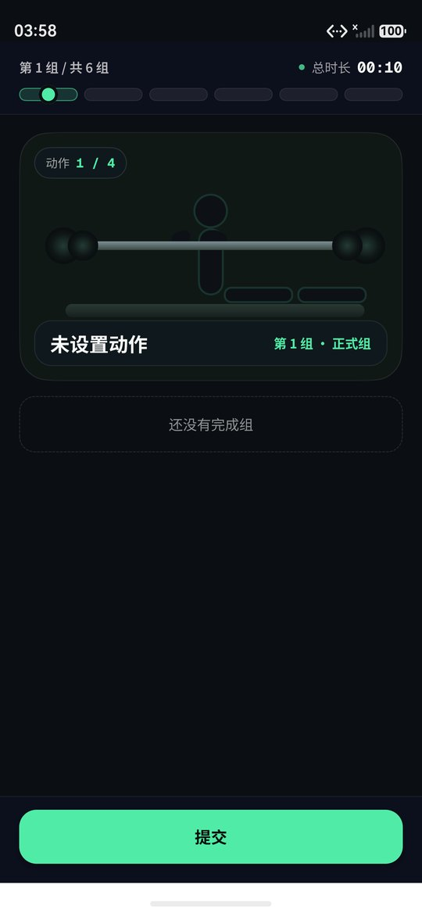
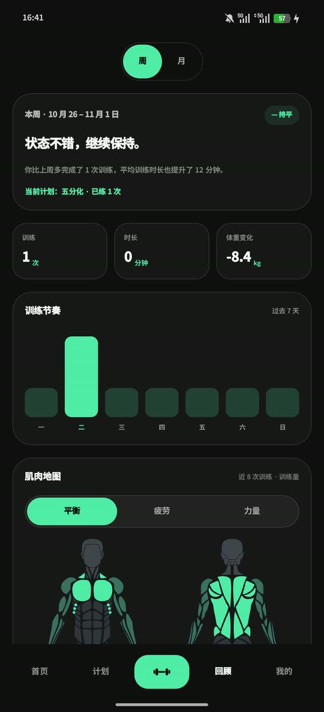
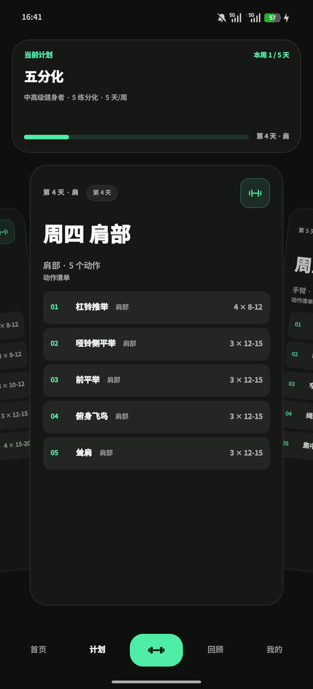
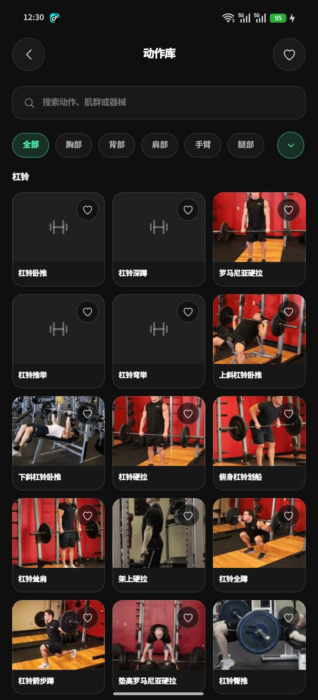
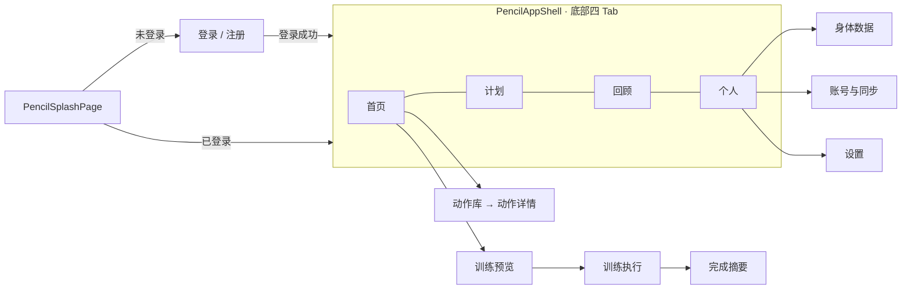

# FitTracker · 菲特

**双端健身训练记录应用。** HarmonyOS（ArkTS / ArkUI）与 Android（Kotlin / Jetpack Compose）各自原生实现，共用一个跨端数据契约；数据保存在本机，登录后自动同步云端整包快照。

[](LICENSE)
[-000000)](apps/harmony)
[](apps/android)
[](https://github.com/EarthxxRhythm/FitTracker/releases)

<p>





</p>

---

## 这个项目解决什么

市面上的健身 App 大多要求先注册账号，数据放在别人的服务器上。FitTracker 同样要求账号，但方向相反：**数据始终落在你自己设备上**，登录后的云同步只是**整包可读 JSON 快照**——备份包结构两端一致，可在 HarmonyOS 与 Android 之间互导（见 `contracts/`）。

它同时也是个相对完整的双端工程样本：两套原生 UI、同一份数据契约、可自托管后端、七条代码门禁，以及一套真正在跑的本地回归脚本。仓库里保留了完整的演进历史和工程约定文档，因为这些东西都还活着。

## 功能

| 模块 | 说明 |
|---|---|
| **训练流** | 训练预览 → 执行（组次录入、组间计时、切动作保留分组）→ 完成摘要 |
| **训练计划** | 按分化数成套的预置计划组（如三分化），可启用落库；首页直接呈现「今日训练」 |
| **训练回顾** | 历史训练、周趋势、动作 PR 下钻、肌肉分布、进阶洞察 |
| **动作库** | 列表 / 筛选 / 收藏 / 详情，内置动作演示 GIF |
| **身体数据** | 体重、体脂等趋势记录 |
| **账号与云同步** | 两端同源：自建服务器（自托管 Supabase，`106.55.37.80`）上的认证服务与整包快照同步；**登录为强制前置**。未配置云端凭据时**自动降级为沙盒演示模式**，功能可跑通 |
| **备份与恢复** | 备份包格式（跨端可读 JSON）与系统备份回调已就绪；**应用内导出 / 导入 UI 尚未接线** |
| **训练强度** | Epley 公式估算 1RM，训练量、连续天数统计 |
| **设置** | 单位、语言、周开始日、各类开关 |

## 架构

```
FitTracker/
├── apps/
│   ├── harmony/          HarmonyOS 应用（ArkTS / ArkUI，Stage 模型）
│   └── android/          Android 应用（Kotlin / Compose，单 app 模块）
├── contracts/            ★ 跨端数据契约（备份包 JSON 真源，两端必须逐条一致）
├── content/              动作内容源（JSONL，两端由脚本同步派生）
├── server/               可选：自托管 Supabase 栈 + Edge Functions + Caddy 部署资产
├── docs/                 设计与工程文档（见 docs/README.md）
├── tools/                根级同步与设备冒烟脚本
└── AGENTS.md             工程约束（改代码前必读）
```

**关键设计：契约层统一、单一后端。** 两端共用同一套自建服务（自托管 Supabase，`106.55.37.80`），「备份包 JSON」是同一份结构——鸿蒙导出的备份应能被 Android 导入，反之亦然。改契约前先改 `contracts/README.md`，再同步两端实现。

## 快速开始

### 一、HarmonyOS 端

前置：[DevEco Studio](https://developer.huawei.com/consumer/cn/deveco-studio/)（含 HarmonyOS SDK 6.0.2）已安装，`devecocli` 在 PATH 中。

```bash
cd apps/harmony
devecocli build --product default                            # 构建 default HAP
devecocli build --modules entry@ohosTest --product default   # 构建测试 HAP
```

产物在 `apps/harmony/entry/build/default/outputs/` 下。安装到真机或模拟器：

```bash
hdc install -r entry/build/default/outputs/default/entry-default-signed.hap
```

缺少 `supabase.json` 时应用进入沙盒演示模式（所有「云端」读写都在本机沙盒内完成），用于本地开发调试。要接真实云端，按 [`server/deploy/README.md`](server/deploy/README.md) 部署后端，再把 `supabase.json`（`url` + `publishableKey`，不入库）放进 `apps/harmony/entry/src/main/resources/rawfile/`。

签名材料放在工作区外（`~/.ohos/config/`），由 `build-profile.json5` 的 `app.signingConfigs` 引用，**不入库**。

### 二、Android 端

前置：Android Studio（JDK 17+）。用 Studio 打开 `apps/android` 即可，`local.properties` 会自动生成。

```bash
cd apps/android
./gradlew :app:assembleDebug
./gradlew :app:testDebugUnitTest          # 单元测试（JUnit + Robolectric，无需设备）
```

**第三方 SDK 说明**：QQ 登录依赖 `app/libs/open_sdk_3.5.19_r9483ffc7_lite.jar`（仓库内已包含）。替换方式与原版许可说明见 [`app/libs/README.md`](apps/android/app/libs/README.md) 与 [THIRD-PARTY-NOTICES.md](THIRD-PARTY-NOTICES.md)。微信登录走 Maven 依赖，无需额外操作。

### 三、服务端（可选）

只有想用自托管后端时才需要。完整部署手册见 [`server/deploy/README.md`](server/deploy/README.md)，环境变量模板见 [`server/deploy/.env.template`](server/deploy/.env.template)（全部为占位符，不含真实密钥）。

## 质量门禁

提交前自检（在 `apps/harmony` 下执行）：

| 命令 | 作用 |
|---|---|
| `node tools/check-gates.mjs` | 总门禁：内容构建 → 页面注册 → 空白检查 → 文档死链 → 规范注册表 → 双端对等 → 代码规则 → 真实 ArkTS 编译 |
| `node tools/check-gates.mjs --skip-build` | 跳过编译段（CI 用这个） |
| `node tools/check-main-pages.mjs` | 校验 `main_pages.json` 中注册的页面文件存在，且每页仅一个 `@Entry` |
| `node tools/check-dead-refs.mjs` | 校验文档 / 配置里的仓库内路径断言是否仍成立 |
| `node tools/check-release-readiness.mjs` | release 前置条件：build mode、签名材料、应用身份、产物、材料未入库 |
| `node tools/content/build-content.mjs` | 校验并构建 `content/exercises/*.jsonl` 内容源 |

根级：

| 命令 | 作用 |
|---|---|
| `node --test "tools/*.test.mjs"` | 根级脚本回归测试（20 项） |
| `cd apps/harmony && node --test "tools/*.test.mjs"` | 鸿蒙工具脚本回归测试（91 项） |
| `node tools/device-smoke.mjs` | 设备冒烟（需已连接设备） |

**CI 现状**：GitHub Actions 跑 `check-gates --skip-build` 与 Android 单测。**HarmonyOS 编译不上公共 CI**——它需要 DevEco Studio 与华为账号授权，公共 runner 装不了。涉及鸿蒙的 PR 请在本地跑一次 `devecocli build --product default` 并附输出。

## 测试

- **Hypium 单元测试（需设备）**：`powershell -ExecutionPolicy Bypass -File tools/ohos-test.ps1`，可选 `-ClassNames` / `-Preset backup|content-sync|full` 过滤，结果写入 `test_run/ohosTest/<时间戳>/`。
- **Android 单元测试**：`./gradlew :app:testDebugUnitTest`。
- **视觉回归**：`tools/visual-diff/compare.py` 等脚本做原型帧与设备截图比对。

## 主路由（HarmonyOS 端）



页面注册唯一事实来源是 `entry/src/main/resources/base/profile/main_pages.json`，代码路由常量来自 `entry/src/main/ets/app/AppRoutes.ets`；新页面必须同时满足「文件存在 + 已注册 + 被引用」。

## 文档导航

| 文档 | 内容 |
|---|---|
| [AGENTS.md](AGENTS.md) | 工程约束：代码边界、服务归属、ArkTS / ArkUI 约定、清理规则 |
| [docs/README.md](docs/README.md) | 文档入口与实现依据索引 |
| [contracts/README.md](contracts/README.md) | 跨端数据契约（改数据结构的起点） |
| [CONTRIBUTING.md](CONTRIBUTING.md) | 提交格式、门禁、双端同步要求 |
| [docs/release/release-build-runbook.md](docs/release/release-build-runbook.md) | 构建与发布工程面 |
| [server/deploy/README.md](server/deploy/README.md) | 自建后端部署手册（现行） |
| [docs/cloud/cloud-setup.md](docs/cloud/cloud-setup.md) | AGC 云服务配置手册（历史方案，已改自建服务器） |
| [docs/CHANGELOG.md](docs/CHANGELOG.md) | 版本说明 |
| [docs/legal/](docs/legal/) | 隐私政策与用户协议 |
| [THIRD-PARTY-NOTICES.md](THIRD-PARTY-NOTICES.md) | 第三方组件与许可 |
| [ASSETS.md](ASSETS.md) | 非代码资源来源与授权 |

## 已知限制

- **云同步需自备配置**：两端共用同一自建后端（自托管 Supabase，`106.55.37.80`），需要 `supabase.json`（HarmonyOS）与对应的服务端地址配置（Android）。未配置时走沙盒演示模式，数据只在本机。
- **微信 / QQ 登录需要开放平台资质**：各平台对移动应用审核有门槛，仓库内的集成代码不代表凭据可用。
- **界面仅简体中文**：`zh_CN` / `en_US` 资源目录已就绪，界面文案仍以代码内中文为主。
- **仅支持 phone**：不响应平板 / 折叠屏专有布局。
- **动作演示素材已裁定并清理**：原「线稿」套系为 Gym Visual 商业素材、授权链条不成立，2026-10-28 已从仓库移除；现仅保留 `free-exercise-db`（Unlicense）的 59 条实拍。覆盖不到的 22 个动作会降级为占位图标，不报错也不破图。详见 [ASSETS.md](ASSETS.md)。
- **`bundleName` 决定应用私有沙箱路径**：改身份会让旧数据在新包下不可见，升级前先导出备份。

## 贡献

欢迎 issue 与 PR。动手前请读 [CONTRIBUTING.md](CONTRIBUTING.md)：

- 提交信息格式 `<type>(<scope>): <中文摘要>`
- 提交前跑质量门禁，任一红即停
- 改动涉及数据结构时，先改 `contracts/` 再同步两端
- 行为准则见 [CODE_OF_CONDUCT.md](.github/CODE_OF_CONDUCT.md)，安全问题走私密渠道（[SECURITY.md](.github/SECURITY.md)）

**适合新手上手的入手点**：Android 端补英文资源、动作库筛选条件的边界处理、文档路径断言修复，以及 [`docs/blockers.md`](docs/blockers.md) 里登记的活跃卡点。

## 许可

源代码以 **Apache License 2.0** 授权，见 [LICENSE](LICENSE) 与 [NOTICE](NOTICE)。

第三方组件（字体、SDK、图标、品牌标识）各有自己的许可，详见 [THIRD-PARTY-NOTICES.md](THIRD-PARTY-NOTICES.md)。特别提示：`apps/android/app/libs/open_sdk_*.jar` 是腾讯官方分发的 SDK 二进制，**不受 Apache-2.0 覆盖**。
