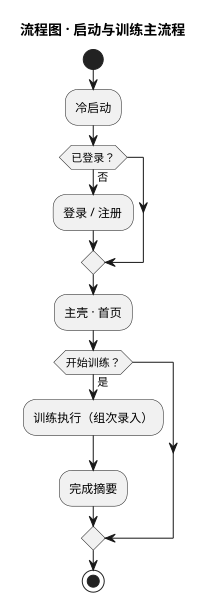
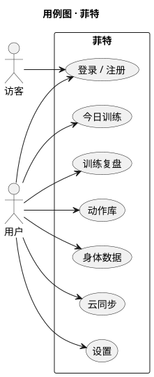
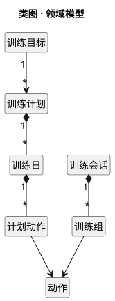
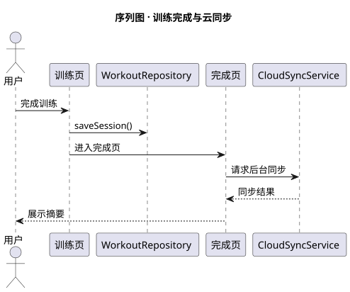

# 菲特 FitTracker · 系统图集（极简）

> 工具：**PlantUML**（UML 原生，语法最短）｜源文件：`fittracker.puml`｜渲染：`java -jar plantuml.jar fittracker.puml`

## 流程图 · 启动与训练主流程



## 用例图



## 类图 · 领域模型



## 序列图 · 训练完成与云同步



---

四张图均由 `fittracker.puml` 一个文件渲染产生（改一行即可重画）：

```bash
java -jar plantuml.jar fittracker.puml   # 产出 flow / use-case / class / sequence 四张图
```
