# 菲特（FitTracker）系统图集

> 流程图 · 用例图 · 类图 · 序列图
> 生成日期：2026-10-12 ｜ 依据版本：`apps\harmony` @ HEAD `0ff159e`
> 所有图均以仓库当前代码为准，节点旁附 `文件:行号` 锚点；Mermaid 源码可直接渲染（已用 mermaid 11 解析器实测）。

## 0. 范围与依据

| 项 | 说明 |
| --- | --- |
| 图集对象 | `apps\harmony`（HarmonyOS 主线：ArkTS / ArkUI，Stage 模型，单 `entry` 模块） |
| 未覆盖 | `apps\android`（独立的 Kotlin 实现，153 个 `.kt`）与 `apps\harmony` 是同一产品的双端实现，本图集不展开，见 §5 |
| 页面注册真源 | `apps\harmony\entry\src\main\resources\base\profile\main_pages.json`（实为 **19** 项，见 §5） |
| 代码路由真源 | `apps\harmony\entry\src\main\ets\app\AppRoutes.ets` |
| 分层约定 | `features/*`（页面与界面体）→ `shared/services`（跨功能服务）→ `common/services`（稳定基础服务）；服务均为模块级 singleton（`export default new Xxx()`） |

三层依赖方向（单一方向，无反向依赖）：

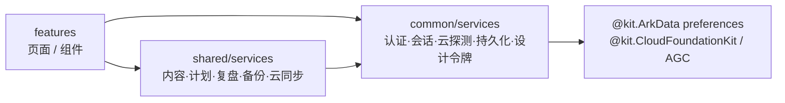

---

## 1. 流程图

### 1.1 冷启动分流

依据：`entryability\EntryAbility.ets`、`features\pencil\pages\PencilSplashPage.ets:122`（testMode 判定与分流）、`app\AppState.ets:27`（`StartupDecision.getInitialRoute`）。

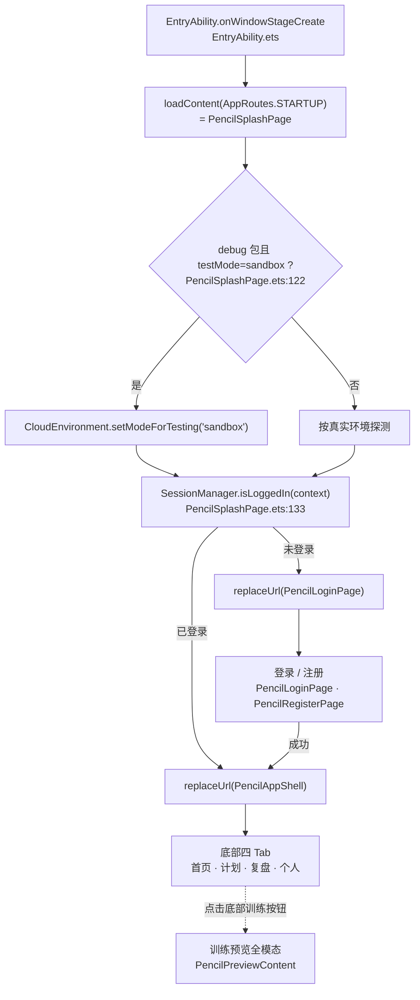

> `StartupDecision.getInitialRoute(hasValidSession, hasGoal)` 当前只按登录态分流；`hasGoal` 保留签名但不参与决策（原「训练目标」引导页已移除，无目标场景由首页空态承接）。

### 1.2 训练主流程（预览 → 执行 → 完成）

依据：`app\PencilAppShell.ets:28,173`（`showPreview` 状态与 `PencilPreviewContent` 全模态）、`features\pencil\components\ActiveContent.ets:271`（`finish`）、`:333,364`（`saveCompletedSession` → `WorkoutRepository.saveSession`）、`features\workout\pages\WorkoutCompletePage.ets:79,145`（`triggerCloudSync` / `loadPersistedSessions`）。

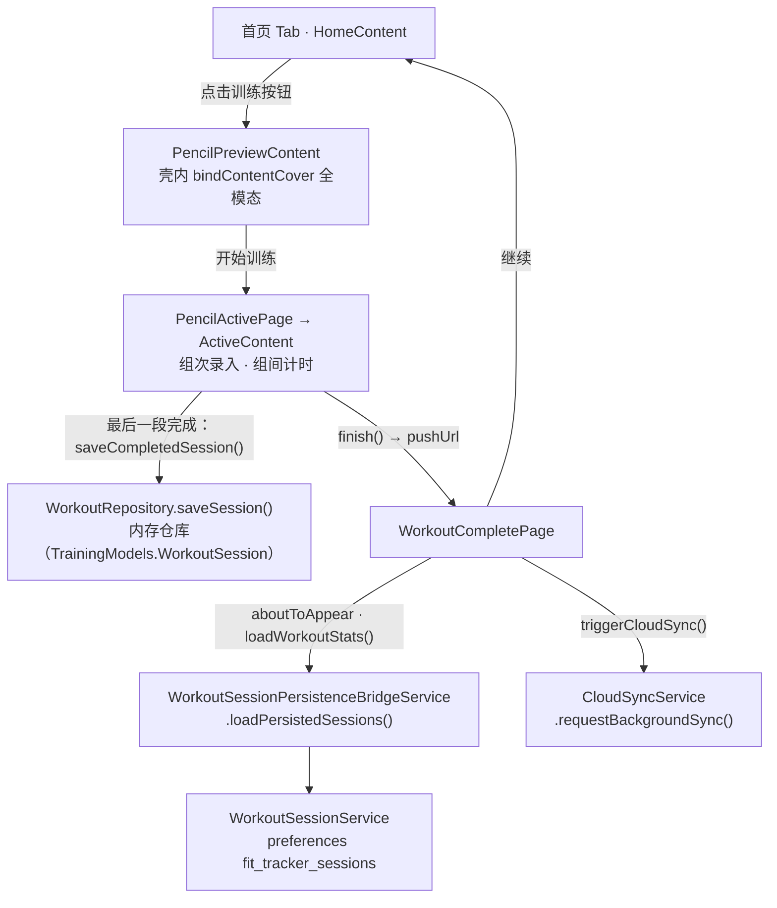

### 1.3 云同步决策（整包快照）

依据：`shared\services\CloudSyncService.ets:80`（`decideSyncAction`）、`:146`（`syncNow`）、`:325`（`resolveStore`）。

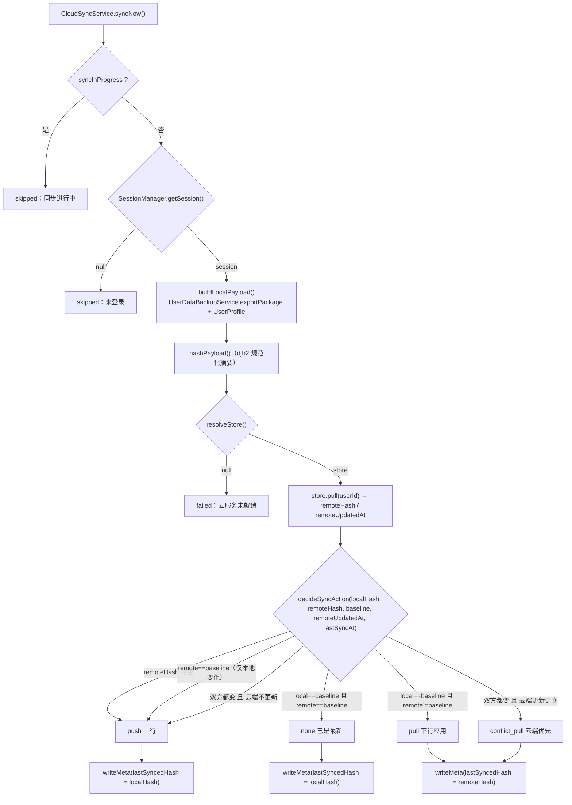

### 1.4 认证/同步后端解析（环境探测 + 降级）

依据：`common\services\CloudEnvironment.ets:58`（`getBackend`）、`:95`（`ensureCloudDatabaseReady`）、`common\services\AuthService.ets:127`（`resolveProvider`）。

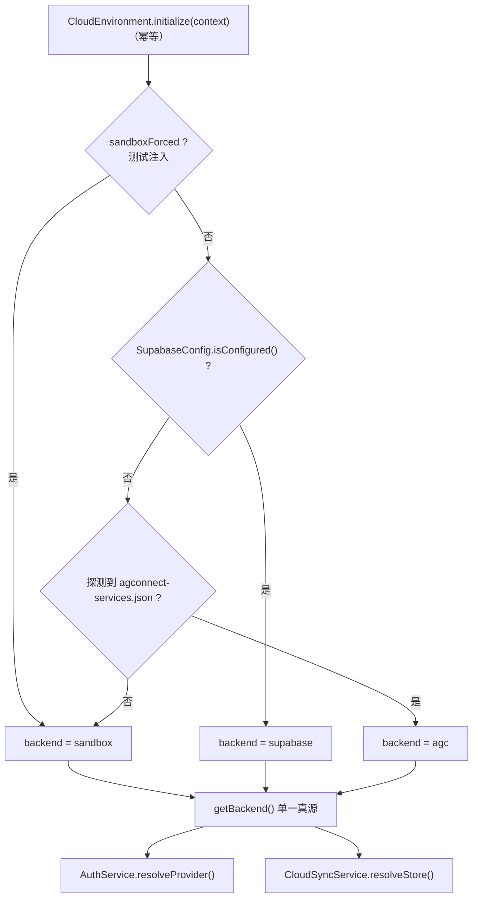

> 优先级：测试强制 sandbox > 显式 Supabase 配置 > 探测到的 AGC > 沙盒兜底。认证与同步两条链路都以 `getBackend()` 为判据。

---

## 2. 用例图

> 说明：Mermaid 无原生用例图，此处以 `flowchart` 的圆形节点表示参与者（Actor）、体育场形节点表示用例（Use Case）。参与关系的依据为 §3 的页面清单与 `AppRoutes.ets` 常量。

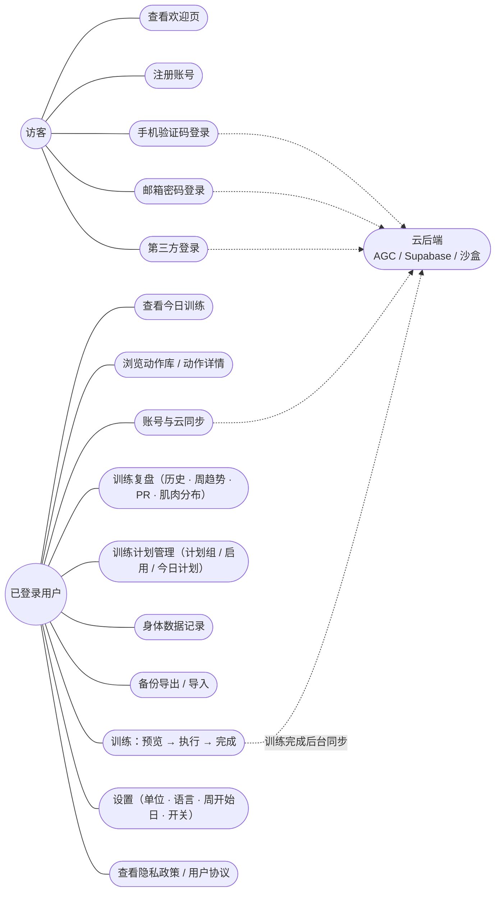

用例 → 页面/服务落点：

| 用例 | 承载页面 | 关键服务 |
| --- | --- | --- |
| 登录 / 注册 | `PencilLoginPage` · `PencilRegisterPage` | `AuthService` → `AuthProvider` |
| 查看今日训练 | `PencilHomePage`（`HomeContent`） | `HomePlanService` · `TrainingPlanService` |
| 训练执行 | `PencilActivePage`（`ActiveContent`） | `ActiveWorkoutService` · `WorkoutRepository` |
| 训练完成 | `WorkoutCompletePage` | `WorkoutSummaryService` · `WorkoutSessionService` |
| 训练复盘 | `PencilReviewPage`（`ReviewContent`） | `ReviewDashboardService` · `ReviewInsightsService` · `PersonalRecordService` |
| 动作库 | `ExerciseLibraryPage` · `ExerciseDetailPage` | `ExerciseService` · `ContentRepository` |
| 身体数据 | `BodyDataPage`（`BodyDataContent`） | — |
| 设置 | `PencilSettingsPage` | `SettingsService` |
| 账号与云同步 | `AccountSyncPage` | `CloudSyncService` · `UserProfileService` |
| 备份 | （设置页入口） | `UserDataBackupService` · `SystemBackupBridgeService` |

---

## 3. 类图

### 3.1 领域模型（`shared\models\TrainingModels.ets`）

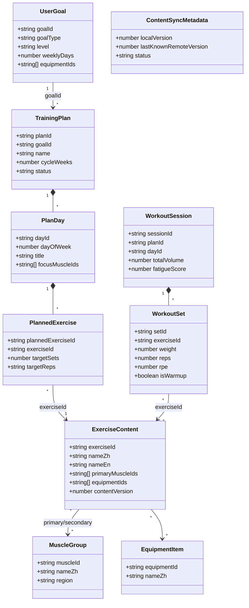

> `TrainingModels.ets` 另提供纯函数 `estimateOneRepMax(weight, reps)`（Epley 公式 `w·(1+reps/30)`，四舍五入两位小数），是 PR 计算的唯一公式来源。

### 3.2 服务分层（按职责簇）

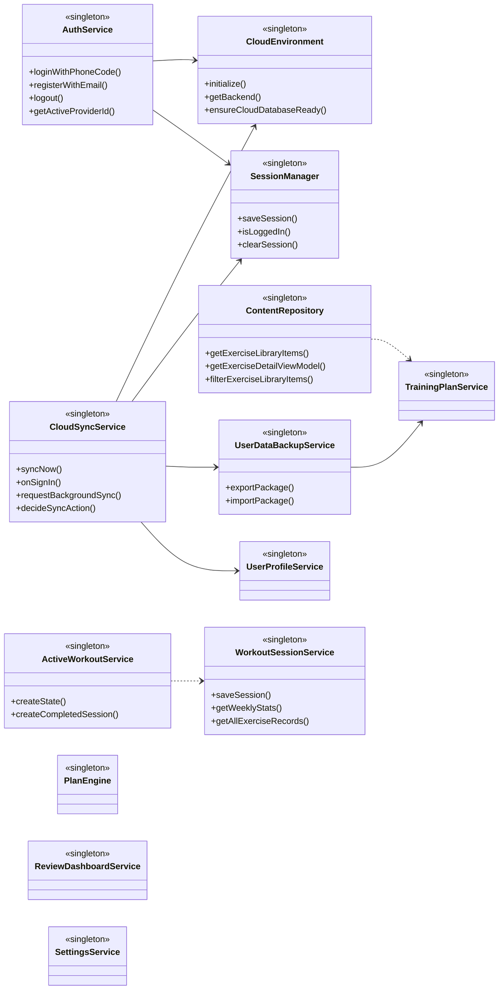

### 3.3 认证后端：策略模式（`common\services\auth\`）

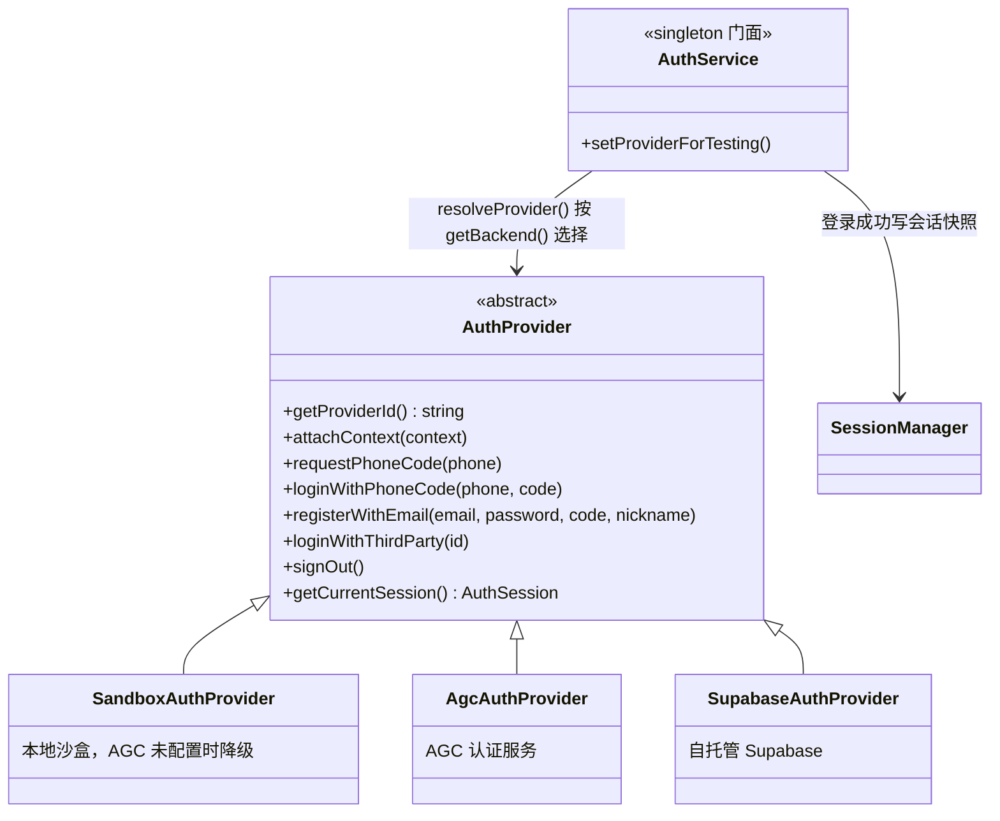

> `AuthProvider.ets` 的注释仅列 Sandbox / AGC 两种实现，但 `AuthService.ets:13,127` 已接入 `SupabaseAuthProvider`——文档注释滞后于代码。

### 3.4 云存储：策略模式（`shared\services\`）

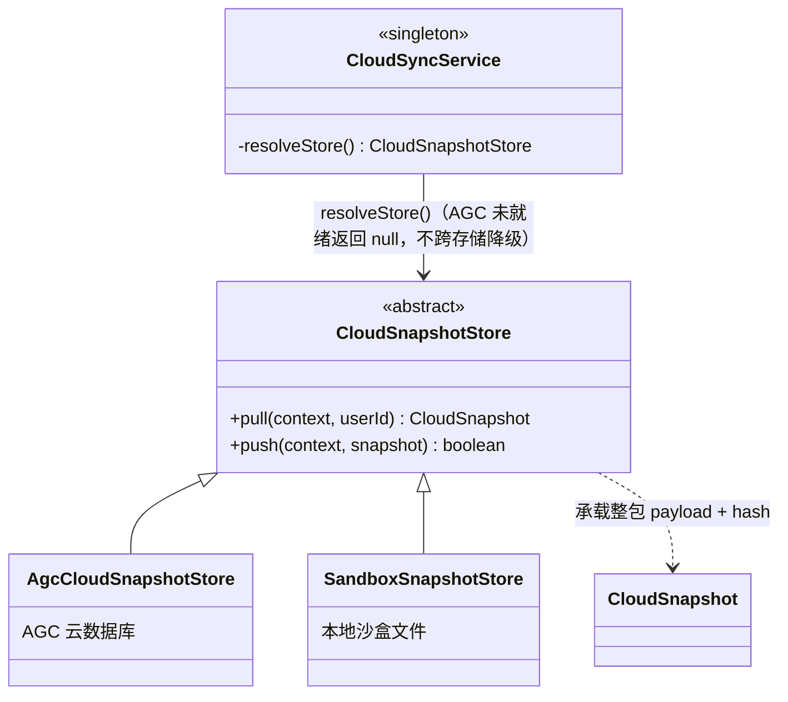

### 3.5 训练数据的双模型与兼容桥

同名 `WorkoutSession` 存在两套定义，桥接服务负责双向转换（AGENTS.md 明确要求保留，勿删）：

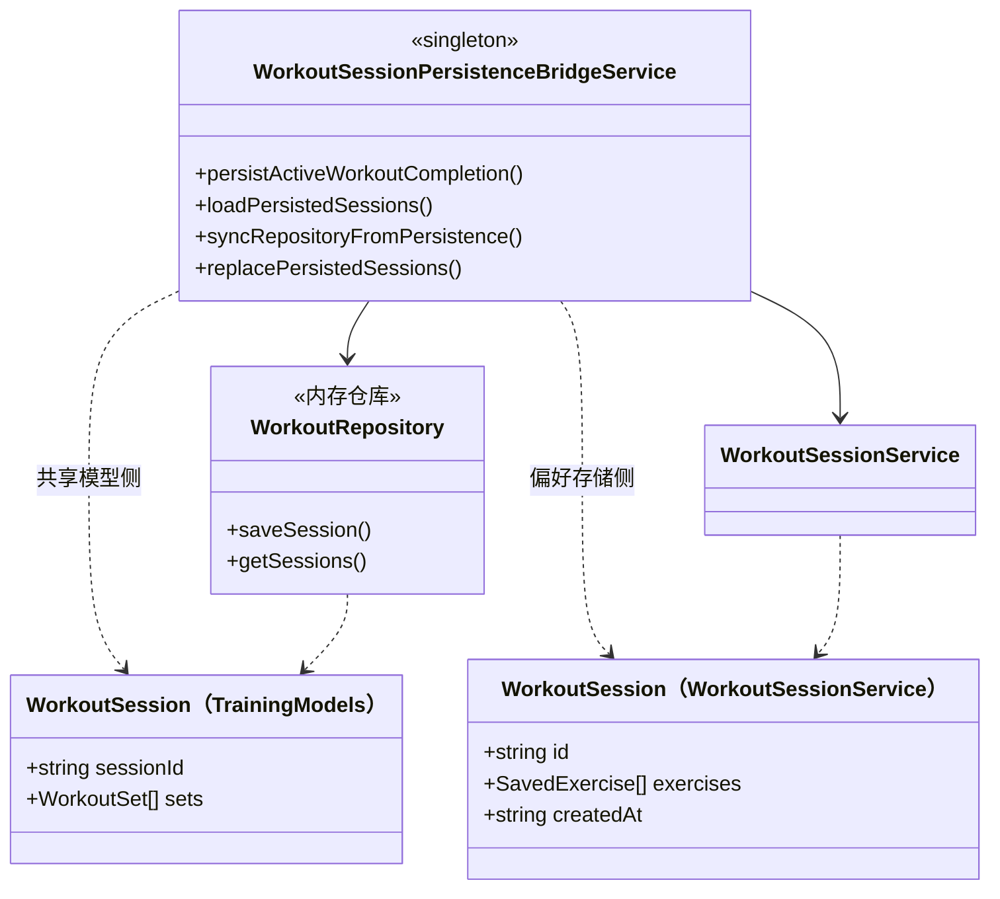

> `createLegacySession` / `createSharedSession` 在两侧模型间做字段映射，并借 `ContentRepository` 把 `exerciseId` 与中文名/别名互相解析（`WorkoutSessionPersistenceBridgeService.ets:70,88`）。

---

## 4. 序列图

### 4.1 登录（以手机验证码为例）

依据：`features\pencil\pages\PencilLoginPage.ets:172`、`common\services\AuthService.ets:46`、`shared\services\CloudSyncService.ets:221`。

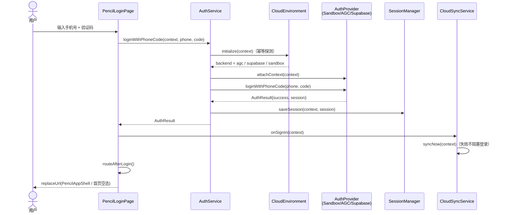

### 4.2 完成训练 → 落库 → 后台云同步

依据：`features\pencil\components\ActiveContent.ets:271,333,364`、`features\workout\pages\WorkoutCompletePage.ets:79,136,145`。

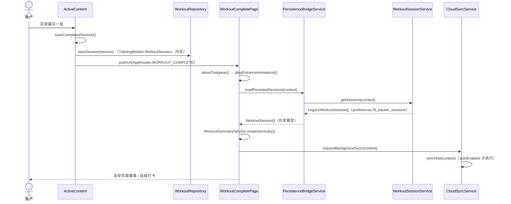

> ⚠ 观察：`ActiveContent.saveCompletedSession()` 只写入内存 `WorkoutRepository`（`ActiveContent.ets:364`），而完成页从 preferences 读取（`WorkoutCompletePage.ets:145`）。把内存态回写持久化的是 `WorkoutSessionPersistenceBridgeService.persistActiveWorkoutCompletion()`，但它在**生产代码中未见调用方**（仅 `ohosTest\ets\test\TargetLoopFlow.test.ets:198,256,310` 调用）。该链路是否在运行时导致「完成页读不到刚结束的会话」需在设备上实测确认，本图集仅如实标注，不作结论。

### 4.3 云同步内部（`syncNow` 六态决策）

依据：`shared\services\CloudSyncService.ets:146-218`。

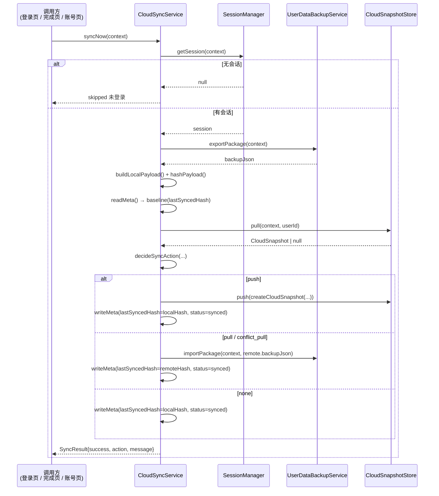

---

## 5. 观察与已知偏差

以下为静态阅读中发现的、与文档描述不一致或值得复核之处，均附锚点，供后续核实：

1. **页面数 19 ≠ 文档的 18**：`main_pages.json` 实际注册 19 项（含 `features/settings/pages/LegalDocPage`），而 `README.md` 与 `AGENTS.md` 均记为 18 页。以 `main_pages.json` 为准。
2. **`AuthProvider` 注释滞后**：`auth\AuthProvider.ets` 注释只列 Sandbox / AGC，实际 `AuthService.ets:13` 已导入并接入 `SupabaseAuthProvider`（`resolveProvider` 在 `backend === 'supabase'` 时返回它，`AuthService.ets:127`）。
3. **训练落库链路存疑**（见 §4.2 ⚠）：内存态 → 持久化的桥 `persistActiveWorkoutCompletion` 在生产代码中无调用方（仅测试调用），而完成页从持久化读取。
4. **双 `WorkoutSession` 模型并存**：`shared\models\TrainingModels.ets` 与 `common\services\WorkoutSessionService.ets` 各定义一套，由 `WorkoutSessionPersistenceBridgeService` 桥接（AGENTS.md 要求保留）。阅读训练数据代码时须先确认处于哪一侧模型。
5. **`WORKOUT_PREVIEW` 路由常量已非路由页**：`AppRoutes.ets:19` 注释说明训练预览改为壳内全模态，该常量仅作「开始训练入口」标识，无生产代码据此 `pushUrl`。

### android 端（`apps\android`）

同一产品的 Kotlin 实现（`app\` + Gradle，153 个 `.kt`），由 `chore(repo): 同步原仓库最新改动进 apps/android` 类提交同步进本 monorepo。若需要 android 端的对应四类图（模块分层、Activity/Fragment 用例、Repository/ViewModel 类图、登录与同步序列），可在本文件基础上另追加一节——其架构与 HarmonyOS 端并非一一对应，需单独调研。
