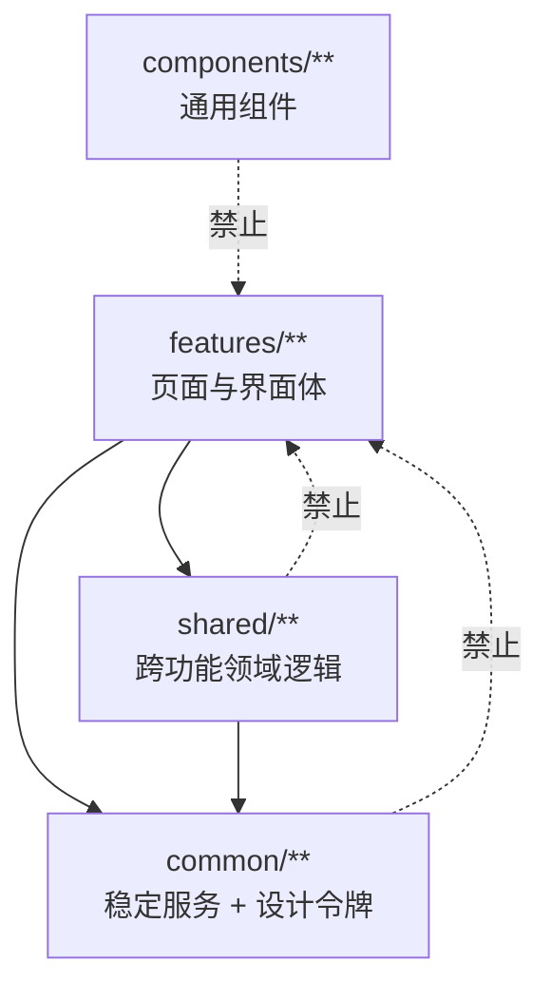

# 菲特 工程规范细则（鸿蒙）

> **层级**：L2 展开
> **最后核对**：2026-10-27
> **上位文档**：`AGENTS.md`（冲突以 L1 为准）
> **状态**：现行
> **路径基准**：文中 `tools\…` 相对 `apps\harmony\`，`docs\…` 与 `apps\…` 相对仓库根
> **适用端**：仅鸿蒙（双端共用约束见 `dual-platform-parity.md`）

## 为什么需要这份文档

`AGENTS.md:50-59` 用 8 条短句列了 ArkTS / ArkUI 约定，但没给正反例、没给 rule id、也没说由谁检查。本文件是它的展开：每条硬规则有 id，`check-code-rules.mjs` 用同一 id 报错，可以双向 grep 追溯——文档说「为什么」，脚本说「怎么查」，同一把钥匙对齐。

原 `docs\ui\设计系统代码规范文档.md`（2026-05-23「MVP 收口版」）的有效内容已并入本文，该文件已删除。失效内容（`features/onboarding/`、`GOAL_SETUP` 路由、`pages/HomePage`）未迁移。

## 一、代码规则总表

| rule id | 约束 | 判据 | 自动检查 |
|---|---|---|---|
| RT-01 | 页面注册与路由常量双向一致 | `main_pages.json` ↔ `AppRoutes.ets` | ✅ `check-code-rules` |
| RT-02 | 禁止硬编码路由字面量 | `pushUrl` / `url:` 后接字面量 | ✅ `check-code-rules` |
| SV-01 | 服务模块级单例，禁止重复实例化 | import 默认导出后又 `new` 同名 | ✅ `check-code-rules` |
| AR-01 | `common\` 不得依赖 `features\` | import 路径 | ✅ `check-code-rules` |
| AR-02 | `shared\` 不得依赖 `features\` | import 路径（3 处兼容层豁免） | ✅ `check-code-rules` |
| AR-03 | `components\` 不得依赖 `features\` | import 路径 | ✅ `check-code-rules` |
| DS-01 | 禁止内联魔法色值 | 属性方法实参位置的色值字面量 | ✅ `check-code-rules`（38 处基线） |

## 二、RT 路由规范

### RT-01 页面注册与路由常量双向一致

**为什么单独建模**：`check-main-pages.mjs:30-43` 只做 `existsSync` + `@Entry` 计数，**不解析 `AppRoutes.ets`**。`AGENTS.md:24-26` 要求的三件套（文件存在 + 注册 + 被 AppRoutes 引用），第三件此前完全没有闸门。

**加新页面三步，缺一步门禁就红**：

1. 在 `features\<feature>\pages\` 建文件，用 `@Entry @Component struct`，全文件恰好一个 `@Entry`
2. 注册到 `entry\src\main\resources\base\profile\main_pages.json` 的 `src` 数组
3. 在 `app\AppRoutes.ets` 加 `static readonly NAME: string = '<同一路径>'`

**豁免怎么写**：不是路由页的（如由壳内条件渲染的覆盖层），在 `check-code-rules.mjs` 的 `EXEMPTIONS` 里加一条，`reason` 与 `ref` 必填：

```js
{
  rule: 'RT-01',
  target: 'features/pencil/pages/PencilPreviewPage',
  reason: '训练预览由 PencilAppShell.build() 条件渲染成壳内覆盖层（非 bindContentCover），不是路由页',
  ref: 'app/AppRoutes.ets:17-20'
}
```

### RT-02 禁止硬编码路由字面量

**为什么**：路由名散落成字符串后，改路径要全库搜替换；`AppRoutes` 常量是唯一事实源。

**会被拦的两种写法**：

```ts
router.pushUrl('features/pencil/pages/PencilHomePage')            // 字符串直传
router.pushUrl({ url: 'features/pencil/pages/PencilHomePage' })   // 对象字段直传
router.replaceUrl('features/settings/pages/LegalDocPage')
```

**正确写法**：

```ts
this.getUIContext().getRouter().pushUrl({ url: AppRoutes.HOME })
```

## 三、SV 服务层规范

### SV-01 模块级单例

**约定**：

- 服务一律 `export default new ServiceName()`，调用方直接导入默认实例
- 调用方**禁止**对已导入的服务再 `new`（会造成两份状态，UI 读到旧的那份）
- 需要系统上下文的异步方法显式接收 `Context` 参数
- preferences store 名称集中在 `app\AppState.ets` 的 `FitTrackerStores`，写入后必须 `flush()`
- 服务层返回业务模型，不返回 UI 文案

**边界（2026-10 实测，容易误判）**：工厂式 `new` 是**允许**的——构造的是本文件内的实现类，不是导入的单例：

```ts
// allowed：SyncService.ets:383，构造 store 实现，注入 prefs
return new ArkPreferencesContentSyncStore(prefs)

// allowed：WorkoutSessionService.ets:228
return new ArkPreferencesSessionStore(prefs)

// 被拦：import 了单例服务再 new 同名
import BodyRecordService from './BodyRecordService'
const mine = new BodyRecordService()   // ❌ RT-01/SV-01 报错
```

**平台上下文获取（旧写法已淘汰）**：`getContext(this)` 在本仓库 **0 处命中**，一律用：

```ts
const context: Context | undefined = this.getUIContext().getHostContext()
```

## 四、AR 分层边界

**为什么**：分层从未被显式建模，只被「自然遵守」过。2026-10 首次实测依赖方向，才发现 `shared → features` 有 3 处反向依赖——它们是兼容层的有意例外，但没有写进任何文档，下一个改 `shared` 的人无从判断是允许的还是漏网的。



| rule | 约束 | 存量 |
|---|---|---|
| AR-01 | `common\` 不得 import `features\` | 0 |
| AR-02 | `shared\` 不得 import `features\` | 3 处豁免 |
| AR-03 | `components\` 不得 import `features\` | 0 |

**`common → shared` 是允许方向**，不禁止。实测 `common\services\TrainingPlanService.ets:10-12` 依赖 `GoalRepository` / `PlanEngine` / `ContentRepository`——那是「门面调引擎」的合理结构，不是腐化。若把这条也禁掉，`TrainingPlanService` 就得重构，收益远小于代价。

**AR-02 的 3 处豁免**（均 import `features/workout/services/WorkoutSessionPersistenceBridgeService`）：

| 文件 | 为什么允许 | 依据 |
|---|---|---|
| `shared\services\UserDataBackupService.ets:10` | 备份须覆盖训练兼容层数据 | `AGENTS.md:48-49` |
| `shared\services\AccountDataLifecycle.ets:13` | 账号数据生命周期须清理训练兼容层 | 同上 |
| `shared\services\DeviceSeedService.ets:17` | 设备种子数据须经兼容层写入，保证旧数据可见 | 同上 |

`WorkoutSessionPersistenceBridgeService` 与 `PersistenceFallbackService` 保护已有本地训练数据。除非明确完成数据迁移，**不要删除或绕过**。

## 五、DS 设计系统规范

### DS-01 颜色与视觉 token

**优先取 `common\styles\DesignTokens.ets`**：

| 类型 | token |
|---|---|
| 颜色 | `ColorTokens.*` |
| 字号 | `FontTokens.*` |
| 间距 | `SpacingTokens.*` |
| 圆角 | `RadiusTokens.*` |
| 触控尺寸 | `TouchTokens.*` |

同目录还有 `DuTokens.ets`、`PrototypeTokens.ets`，均可用。

**禁止**：

- 在页面内硬编码品牌色、背景色、正文色
- 为同类按钮随意增加阴影或圆角
- 在按钮、卡片、列表中使用不一致的 padding

**允许**：

- 百分比宽高如 `'100%'`
- 业务相关数字：训练天数、动作组数、分钟数
- ArkUI 必需的少量固定尺寸——但应优先沉淀到 token

**合规范本**（feature 内集中声明的视觉 token，`AGENTS.md:57` 明确允许）。`features\pencil\components\ReviewContent.ets:63-70`：

```ts
const SILHOUETTE_FILL: string = '#3F454A'
const BODY_PATH_STROKE: string = '#171D24'
const MUSCLE_BASE_FILL: string = '#30353B'
const HEATMAP_CELL_BASE: string = '#09FFFFFF'
const HEATMAP_CELL_L1: string = '#4C5A57'
const HEATMAP_CELL_L2: string = '#618B7B'
const HEATMAP_CELL_L3: string = '#63BB95'
```

**被拦的是内联**，不是命名常量：

```ts
.backgroundColor('#F00D1117')   // ❌ DS-01 报错（属性方法实参位置的裸字面量）
const CARD_BG: string = '#F00D1117'   // ✅ 命名常量，合规
```

**存量**：38 处内联色值 / 16 个文件，记录在 `apps\harmony\tools\code-rules-baseline.json`。基线机制是**记账不是免责**——每修一处就从基线删一条，新代码不允许再写进基线。

## 六、ArkTS 严格模式补充

`AGENTS.md:56` 的展开。所有 `.ets` 文件必须遵守：

**类型**：

- 不使用 `any`、`unknown`、`as any`、`as const`
- 对象字面量必须对应明确的 `interface` 或 `class`
- 数组必须有明确元素类型，如 `const items: Exercise[] = []`

**语法**：

- 不使用对象解构、数组解构、`for..in`、`in` 运算符
- 不使用动态索引访问，如 `obj["field"]`
- 不使用嵌套函数声明；需要局部行为时用箭头函数属性或拆成方法
- 不使用 `require`、`globalThis`、命名空间模拟对象
- import 必须位于文件顶部（注释可作为文件头保留）

**推荐模式**：

```ts
interface GoalOption {
  id: string
  title: string
}

function createGoalOption(id: string, title: string): GoalOption {
  const option: GoalOption = {
    id: id,
    title: title
  }
  return option
}
```

## 七、文案规范

- 所有用户可见文本使用简体中文
- 页面标题用名词短语：`今日训练`、`训练预览`、`训练执行`、`训练完成`、`训练回顾`
- 按钮文案用动作短语：`开始今日训练`、`查看训练回顾`、`调整训练目标`
- 不使用开发占位文案：`placeholder`、`TODO`、`Coming soon`

## 八、动作与视频内容规范

- 不接入 MuscleWiki 官方 API
- 不内置未授权视频、图片或动作数据
- 动作数据进入自建库后，通过内容服务或本地数据库读取
- 页面不得直接写死大批动作内容；临时数据应集中在计划或内容服务中

## 本文的验证边界

- RT / SV / AR / DS 七条规则由 `apps\harmony\tools\check-code-rules.mjs` 自动校验
- DS-01 的 38 处存量走基线，**不代表已修**
- AR 分层的「行为等价」无法静态验证，只校验 import 路径
- 第六节 ArkTS 严格模式大部分由 ArkTS 编译器本身强制，本文档只补 `code-linter.json5` 未覆盖的部分
