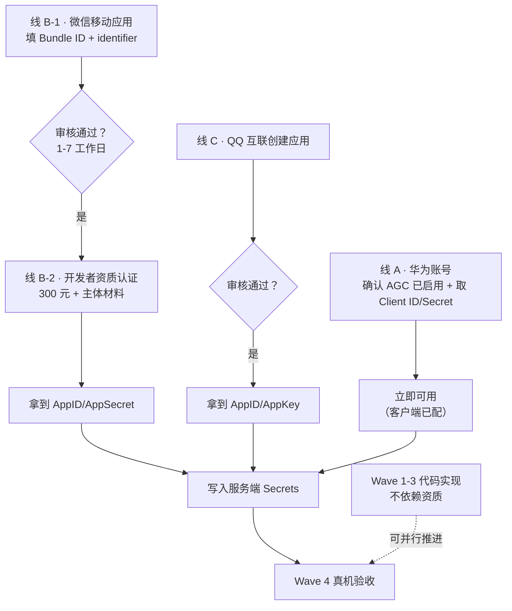

# 第三方登录资质申请操作手册

> 用途：指导完成 FitTracker 第三方登录（微信 / QQ / 华为账号）所需的开放平台资质申请。
> 背景：`.rivet/plans/fittracker-第三方登录模块-华为账号-微信-qq-开发计划.md` 的 Wave 0。
> 编制日期：2026-10-14（本项目参数已逐个核实，见 §1）
> 状态：**待人工执行**（各平台表单需登录账号操作，Agent 无法代办）

---

## 1. 你的项目参数（填表直接复制这些值）

这些值已从当前工作树核实，**填错会导致审核驳回或运行时校验失败**。

| 参数 | 值 | 来源 |
| --- | --- | --- |
| Bundle ID（包名） | `com.earthrhythm.fittracker` | `apps/harmony/AppScope/app.json5` |
| 应用名称 | 菲特（FitTracker） | `AppScope/resources/base/element/string.json` |
| iOS Bundle ID | **无**（本项目无 iOS 端） | — |
| 安卓包名 | `com.earthrhythm.fittracker` | `apps/android/app/build.gradle.kts`（applicationId，与鸿蒙统一） |
| 鸿蒙 release appIdentifier | `6917617822424327740` | `~/.ohos/release-keys/fittracker_release.p7b` 提取 |
| 鸿蒙 debug appIdentifier | `6918742142862924944` | `~/.ohos/config/default_FitTracker_*.p7b` 提取 |
| 网站地址 | `https://api.earthrhythm.cloud`（现有自托管后端域名，可作应用官网） | `docs/cloud/supabase-sync-setup.md` |

### ⚠ appIdentifier 有 debug / release 两个值 —— 这是最容易踩的坑

从签名 profile 实测提取到**两个不同的 appIdentifier**：

```
release 签名 → 6917617822424327740   （build-profile.json5 signingConfigs.material.profile 指向 .ohos/release-keys/）
debug   签名 → 6918742142862924944   （.ohos/config/ 下 IDE 自动生成的调试证书）
```

腾讯官方 FAQ 明确警告这一点：

> 「开发者可自查确认是否在用 IDE 的方式自动生成的签名（这个签名和开发者账号有关，有可能生成出来的就会不一样）。**如有测试需求，建议申请新的移动应用账号用于生成 debug 签名**」

**建议做法（按推荐度排序）**：

1. **申请两个微信移动应用**（推荐）：一个填 release 的 appIdentifier 用于正式发布，一个填 debug 的用于开发测试。这是腾讯官方推荐路径，可避免开发期反复改配置。
2. **只申请一个，填 release 值**：开发测试阶段微信登录会报「Bundle ID 信息校验不通过」，但正式包可用。适合能接受开发期不测微信登录的情况。
3. **统一签名**：把 debug 构建也改用 release 签名材料（`build-profile.json5` 的 debug 模式指向 release p12）。改动签名配置有回归风险，需重新验证全部调试流程（见 `docs/release/release-build-runbook.md`）。

> **关键**：无论选哪种，微信开放平台填的 identifier 必须与**实际运行该包的签名**一致。混填必然失败。

---

## 2. 三条线一览

| 线 | 平台 | 当前状态 | 主体要求 | 费用 | 审核时长 | 阻塞什么 |
| --- | --- | --- | --- | --- | --- | --- |
| A · 华为账号 | AGC（已就绪） | ✅ **配置已产出** | 已具备 | 免费 | — | 无（客户端已有 client_id/secret） |
| B · 微信登录 | 微信开放平台 | ❌ 未申请 | **待核实**（见 §3 注） | 资质认证 300 元/年 | 1–7 工作日 | 鸿蒙/安卓微信登录真机验证 |
| C · QQ 登录 | QQ 互联 | ❌ 未申请 | **待核实** | 免费 | 待核实 | 鸿蒙/安卓 QQ 登录真机验证 |

---

## 3. 线 A · 华为账号（几乎无需操作）

**好消息：AGC 侧配置已在仓库中**（`apps/harmony/AppScope/resources/rawfile/agconnect-services.json` 已含 `client_id` / `client_secret` / `project_id`），说明应用已在 AGC 控制台创建并配好了凭证。

**只需确认两件事**：

1. 登录 [AppGallery Connect](https://developer.huawei.com/consumer/cn/service/josp/agc/index.html) → 我的项目 → 选中本项目 → 「构建」→「认证服务」，确认 **Account Kit（华为账号）** 已启用。
2. 记下「项目设置 → 常规」中的 **Client ID** 与 **Client Secret** —— 服务端换票（`thirdparty-exchange` 的 `HUAWEI_CLIENT_ID` / `HUAWEI_CLIENT_SECRET`）需要它们。

**权限说明**：华为官方文档（静默登录指南）明写「此场景无需申请账号权限」，只需签名 + 指纹 + Client ID 配置齐全。社区流传的「需要 `ohos.permission.ACCOUNT_MANAGER`」**未在官方文档中出现**，不建议声明（多余权限会影响上架审核）。

---

## 4. 线 B · 微信开放平台

### 4.1 操作路径（腾讯官方流程）

1. 访问 [微信开放平台](https://open.weixin.qq.com/) → 登录 → **管理中心 → 移动应用 → 创建移动应用**
2. 填写基础信息：
   - 应用名称：`菲特`
   - 应用简介、图标（建议 108×108 以上）、官网地址
   - **上架情况**：若安卓/鸿蒙都未上架，选「未上架任何应用市场」——但注意此选项会**限制可用的微信能力**（官方警告），若功能受限需先上架任一市场
3. 填写**平台信息**（这是鸿蒙接入的核心）：
   - 在「鸿蒙」板块填 **Bundle ID** = `com.earthrhythm.fittracker`、**Identifier** = 你的 appIdentifier（见 §1 的两种值选择）
   - 若本项目安卓也上架，同时填安卓板块（包名相同）
4. 提交审核 → **1–7 个工作日**（官方文档：内容复杂可能延长）
5. 审核通过后获得 **AppID**（形如 `wx` 开头的字符串）

### 4.2 开发者资质认证（微信登录的前置）

「微信登录」属于**需资质认证才能开通**的高级能力。认证路径：

- 控制台 → 账号中心 → **开发者资质认证**
- 费用：中国大陆 **300 元**（非大陆 99 美元）
- 需准备：营业执照或组织证明（**主体要求见下方注**）、对公打款或法人扫码验证、管理员微信保护

### 4.3 ⚠ 主体类型待核实（影响可行性）

**微信开放平台的「移动应用」是否接受个人主体申请，我未能从公开文档确证**——各平台主体选项只在登录后的控制台可见。已知的相邻事实：

- 微信开放平台**开发者资质认证**的 300 元认证通常要求**企业/组织主体**（需营业执照）
- 个人主体在微信生态（小程序）可注册，但**移动应用的微信登录能力**是否开放给个人，官方文档未明确

**请你登录后确认**：
- 若能创建移动应用且能走完资质认证 → 按 §4.1 继续
- 若提示需要企业主体 → 本项目走企业主体（`vendor = EarthRhythm`），或用已有的安卓应用资质（若已在其他平台上架过）

> 这一条不确定，我不编造结论。你在控制台看到什么，可以告诉我，我再补全后续步骤。

---

## 5. 线 C · QQ 互联

### 5.1 操作路径

1. 访问 [QQ 互联](https://connect.qq.com/) → 登录（需 QQ 号）→ **应用管理 → 创建应用**
2. 选择应用类型：**移动应用**
3. 填写信息：
   - 应用名称：`菲特`
   - 包名（安卓/鸿蒙）：`com.earthrhythm.fittracker`
   - 应用签名（Android）：需提供签名 MD5 或 SHA1
   - 鸿蒙侧：按 QQ 官方 [HarmonyOS SDK 环境搭建](https://wiki.connect.qq.com/harmonyos_sdk环境搭建) 说明配置
4. 提交审核 → 获得 **AppID**（数字串）与 **AppKey**

### 5.2 填表注意（来自腾讯官方文档）

- **鸿蒙 `module.json5` 的 `skills.uris[].host` 必须填这个 AppID**，填错会导致 QQ 无法回调（官方原文警告）
- QQ 鸿蒙 SDK 要求宿主开启 `useNormalizedOHMUrl`（本项目**已开启** ✓，见 `apps/harmony/build-profile.json5`）
- `querySchemes` 需声明 `["https", "qqopenapi"]`

### 5.3 主体要求待核实

QQ 互联是否接受个人主体，同样**未从公开文档确证**。与微信不同的是 QQ 互联**没有 300 元认证费**，门槛通常更低（历史上个人可申请）。请登录后确认。

---

## 6. 完成后告诉我什么

三条线各自拿到凭证后，请把**键名对应的值**填入服务端配置（**不要贴到聊天里**——这些是密钥）：

服务端 Secrets（写入 `server/deploy/.env.template` 的 B 段模式，或 Supabase Edge Function Secrets）：

| 键 | 来源 |
| --- | --- |
| `WECHAT_APP_ID` | 微信开放平台审核通过后的 AppID |
| `WECHAT_APP_SECRET` | 微信开放平台「应用详情」中的 AppSecret |
| `QQ_APP_ID` | QQ 互联的应用 AppID（**同时要填进 `module.json5` 的 skills host**） |
| `QQ_APP_KEY` | QQ 互联的 AppKey |
| `HUAWEI_CLIENT_ID` | AGC 项目设置 → 常规 |
| `HUAWEI_CLIENT_SECRET` | AGC 项目设置 → 常规 |
| `SUPABASE_SERVICE_ROLE_KEY` | 自托管栈的 `.env`（`server/deploy/README.md` 有说明） |

客户端配置（非密钥，可入库的模板）：`apps/harmony/AppScope/resources/rawfile/` 下新增第三方配置需与 `supabase.example.json` 同模式（模板入库、真值 gitignore）。

---

## 7. 时间线与阻塞关系



**要点**：Wave 1-3（代码实现）**完全不依赖资质**，可与我并行推进。资质只阻塞 Wave 4 的真机验收。

---

## 8. 我没有验证的事（诚实清单）

| # | 事项 | 为何未验证 |
| --- | --- | --- |
| 1 | 微信开放平台移动应用是否接受**个人主体** | 主体选项只在登录后的控制台可见，公开文档未明确 |
| 2 | QQ 互联是否接受**个人主体** | 同上 |
| 3 | 微信/QQ 移动应用审核的**实际**通过时长 | 官方给的是 1–7 工作日区间，实际个案不可预知 |
| 4 | debug/release 双 appIdentifier 下微信是否真能同时工作 | 需实际申请后真机测试（腾讯 FAQ 提到建议申请两个应用，但未说能否共存） |
| 5 | 微信「未上架任何应用市场」选项的**具体能力限制清单** | 官方仅以图片示意，文档正文未列明细 |
