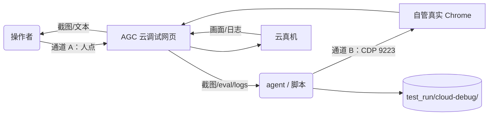

# 云调试（AGC 云真机）操作手册

> 用途：在**无物理设备**条件下，通过华为 AGC「云调试」远程真机完成上传 HAP、安装启动、操作、截图与日志采集。本手册覆盖**两条通道**：A 手动网页操作、B CDP 直控自动化。
> 状态：v0.2（2026-10-09）。v0.1 的手动网页路径来自外部来源；v0.2 新增的通道 B 为 2026-10-09 本机实测（证据见 `test_run/cloud-debug/probe/`）。
> 配套：`.rivet/plans/agent-全自动云调试通道-agc-云真机自动化.md`（全自动路线，APPROVED）、`tools/cloud-debug/`（通道 B 工具）、`docs/release/store-listing-screenshot-checklist.md`（截图内容清单）、`docs/release/release-build-runbook.md` §12（上架材料待办）。

## 0. 证据等级约定

| 标注 | 含义 |
| --- | --- |
| 【本机实测】 | 2026-10-09 在本机 + Pura 90 模拟器 / 真实 Chrome 实例实际执行，有命令输出与落盘记录 |
| 【外部来源】 | 官方文档或第三方实操帖，**未在本机复现** |
| ⚠ | 以 AGC 控制台 / 云真机实际界面为准 |

**诚实边界**：云调试**网页侧**的云真机会话（申请设备、上传安装、控制面板、释放）截至 v0.2 **仍未建立过**——本机从未连上云真机。通道 B 的页面自动化链路**在 AGC 项目页卡住**（见 §5.5）。

---

## 1. 前置条件

| 项 | 本项目状态 |
| --- | --- |
| 华为开发者账号并已登录 AGC | 已有（见 `docs/cloud/cloud-setup.md` §0） |
| AGC 项目 + HarmonyOS 应用（包名 `com.earthrhythm.fittracker`） | 已创建 |
| 已签名 HAP（**release**） | 见 §6 |
| 配额 | 【外部来源】每天 360 分钟免费云真机时长（HarmonyOS 5.0+）；**同一账号同时最多占用 2 台设备**（官方单机调试流程文档） |
| 通道 B 额外依赖 | 本机安装的 Chrome（实测版本 `154.0.8037.98`，路径 `C:\Program Files\Google\Chrome\Application\chrome.exe`）+ Node.js |

> 云调试是**纯网页 GUI** 服务，无面向开发者的公开 CLI/API——这是本项目的既有调研结论（见计划文档 §2.1 F2）。因此只能经由**浏览器**操作，区别仅在于「人来点」还是「脚本驱动」。

---

## 2. 两条通道怎么选

| 通道 | 适用场景 | 依赖 | 实测状态 |
| --- | --- | --- | --- |
| **A 手动网页** | 一次性操作、人守着电脑、需要肉眼确认页面 | 浏览器 + 人手 | 【外部来源】网页流程未复现 |
| **B CDP 直控** | agent 驱动、可重复、要留证据、需注入补丁绕过环境故障 | 真实 Chrome + 调试端口 + `tools/cloud-debug/cdp.mjs` | 【本机实测】工具链已跑通，页面链路卡在项目页（§5.5） |



⚠ **通道 B 的进程隔离是硬约束**：必须用独立 `--user-data-dir` 启动自己的 Chrome 实例，**不得** taskkill / 重启 / 触碰用户日常浏览器进程（跨会话教训）。

---

## 3. 通道 A：手动网页操作

### 3.1 进入云调试

【外部来源】两个入口，功能一致：

1. **AGC 控制台（推荐）**：登录 AGC →「我的项目」→ 选择 FitTracker 项目 → 左侧导航「**质量**」→「**云调试**」
2. 华为开发者联盟门户 → DevEco 产品 → 云调试（适合临时快速调试）

云调试页在 AGC 单页应用内的路由形态（【本机实测】，取自 `probe/hold3.log` 的导航事件）：

```
https://developer.huawei.com/consumer/cn/service/josp/agc/index.html
  #/myProject/<项目ID>/<应用ID>/CloudDebugging?appId=<appId>
```

⚠ 直接拼该 URL 导航**会被重定向**至 `#/InAppDistribution/<应用ID>`（menuCode `CloudDebugging` 已从 bundle 证实存在，但路由守卫不接受冷跳）。**取 URL 的可靠办法**：在已登录的浏览器里手点进云调试页，从地址栏复制完整 URL。

⚠ 「**云测试**」就在「云调试」隔壁，功能完全不同——云测试是上传后平台自动跑兼容性/稳定性回归，**不能交互调试**，截不了素材、做不了登录态验证。别点错。

### 3.2 手动黄金路径

每一步的「成功判据」都要当场确认再进下一步。

| # | 步骤 | 成功判据 | 失败恢复 |
| --- | --- | --- | --- |
| 1 | 在单机调试页选择机型/系统版本 → 申请设备 | 页面出现投屏画面 + 控制面板 | 排队等待；同账号最多 2 台，先释放不用的 |
| 2 | 上传 HAP：页面上传入口 → 选 §6.1 的 release 包 | 上传完成并**自动安装**；页面提示安装成功 | 见 §8 |
| 3 | 启动应用：投屏点图标，或控制面板 shell 面板执行 `aa start -a EntryAbility -b com.earthrhythm.fittracker` | 应用画面出现 | 用 shell 面板 `bm dump -n com.earthrhythm.fittracker` 确认是否装上 |
| 4 | 交互操作：投屏点击/滑动；控制面板支持上传图片到设备、打开网页、复制文本、获取文本【外部来源】 | 设备画面按预期变化 | 投屏坐标漂移时**优先改用 shell 面板命令**直达目标页，别硬点 |
| 5 | 取证据：页面截图功能；日志用 shell 面板 `hilog`（可 `hilog \| grep FitTracker` 过滤） | PNG 落盘 + 日志可读 | — |
| 6 | **释放设备** | 页面显示已释放 | 挂着不用也扣配额，用完即还 |

> 「控制面板支持 hdc/adb 命令输入」【外部来源】：官方《使用控制面板调试》文档原文为「Shell 脚本操作：您可以通过输入 adb/hdc 命令来执行」。命令前缀究竟要不要写 `hdc shell`，以面板 placeholder 提示为准——**未本机复现**。

---

## 4. 通道 B：CDP 直控（自动化）

### 4.1 为什么不用 `browser_debug` 工具

【本机实测，记录于 `tools/cloud-debug/cdp.mjs` 头部注释】该工具的通道在本环境有两个问题：

1. 其内置浏览器为 Playwright Chromium，对「`developer.huawei.com` 页面 → `svc-drcn.developer.huawei.com` 跨域请求」存在**稳定的 TLS 层失败**（`ERR_SSL_BAD_RECORD_MAC_ALERT` / `EMPTY_RESPONSE`），会卡死 AGC 登录流的 `getAccessToken` 环节；**换成本机真实 Chrome 后完全治愈**。
2. 工具 worker 曾整体卡死（连续多次调用 60s 超时）。

因此改为**直连自管真实 Chrome 的远程调试端口**。

### 4.2 启动自管真实 Chrome ← `cdp.mjs` 引用的前置

用**独立 profile** 启动（与用户日常浏览器严格分离）：

```bash
"C:\Program Files\Google\Chrome\Application\chrome.exe" \
  --remote-debugging-port=9223 \
  --user-data-dir="<绝对路径>\test_run\cloud-debug\chrome-profile" \
  --no-first-run \
  "https://developer.huawei.com/consumer/cn/service/josp/agc/index.html"
```

验证端口与页面可达：

```bash
node tools/cloud-debug/cdp.mjs pages
```

⚠ **首次需在此 profile 内人工登录一次 AGC**。登录态保存在该 profile 目录中，之后可复用（本项目实测的登录态即持久化于一个专用 profile，OAuth 续期自动完成、无需重复扫码）。**凭据始终只存在于 profile 目录，任何 cookie/token 值不得写入仓库**。

实测的本机实例（2026-10-09，供对照）：

```
chrome.exe --remote-debugging-port=9223
  --user-data-dir="...\.rivet\browser-debug-profiles\2026100928144b7b0185"
  --no-first-run --do-not-de-elevate
  https://svc-drcn.developer.huawei.com/
```

进程边界记录见 `test_run/cloud-debug/probe/chrome-procs.txt`。

### 4.3 `cdp.mjs` 命令参考

`node tools/cloud-debug/cdp.mjs <命令> [参数]`

| 命令 | 作用 | 示例 |
| --- | --- | --- |
| `pages` | 列出可操作的 page target | `cdp.mjs pages` |
| `eval "<js>"` | 在页面执行表达式（支持 `await`，`awaitPromise`） | `cdp.mjs eval "document.title"` |
| `nav <url>` | 页面导航 | `cdp.mjs nav "https://...#/CloudDebugging"` |
| `screenshot <out.png> [--full]` | 截图落盘（`--full` 含视口外） | `cdp.mjs screenshot test_run/cloud-debug/x.png` |
| `click <x> <y>` | 坐标点击（`mousePressed`/`mouseReleased`） | `cdp.mjs click 640 400` |
| `text <string>` | 输入文本（`Input.insertText`） | `cdp.mjs text "hello"` |
| `key <KeyName>` | 单键（`Enter`/`Tab`/`Escape`…） | `cdp.mjs key Enter` |
| `logs [秒]` | 采集 console / 异常 / 网络失败（默认 8s） | `cdp.mjs logs 10` |
| `inject <file>` | 注册新文档注入脚本 | `cdp.mjs inject tools/cloud-debug/inject-net-retry.js` |
| `hold-inject <file> <分钟>` | 注册注入脚本并**保持长连接** | `cdp.mjs hold-inject tools/cloud-debug/inject-net-retry.js 10` |
| `frame-eval <url子串> <js>` | 在指定 **iframe/frame** 内执行 JS（`Page.getFrameTree` + `Page.createIsolatedWorld` + contextId；云调试面板在 iframe 内，必用） | `cdp.mjs frame-eval "cloud-debugging/cn/index.html" "document.title"` |

环境变量：`CDP_PORT`（默认 `9223`）、`CDP_TAB`（按 URL 子串选择目标页；不设时取第一个非 `about:blank` 页面）。

### 4.4 网络重试补丁

**背景（环境级根因）**：本机对「**新建的 TLS 连接**」存在间歇性干扰——`net::ERR_SSL_BAD_RECORD_MAC_ALERT` / `net::ERR_CONNECTION_RESET`，特征是每次新连接会话的**头 1-2 发请求**被干扰，重试或复用连接即恢复正常。**AGC 前端自身没有请求重试逻辑**，任何一个关键请求撞上该窗口都会让页面流程永久卡死（实测到的直接后果：`svc-drcn.../codeserver/oauth2/v1/refreshAccessToken` 失败 → `aui2-login-developer.js` 抛 `SyntaxError: Unexpected end of JSON input`，登录流中断）。

**排除项（均已对照实测）**：非代理（`--no-proxy-server` 直连同样复现，curl 经代理/直连均可通）；非浏览器二进制（用户 Chrome 与自动化实例同为同一 exe）；与 **profile 内的连接层状态**强相关——全新 profile 对 `svc-drcn` 的 6/6 请求全通，迁移来的 profile 6/6 全败；清理网络状态后 2 败 4 成，热连接后 6/6 通过。

**三类补偿对策**：

1. **预热**：对关键域先发几发 `no-cors` GET，把「失败的窗口」提前消耗掉。
2. **重试补丁** `tools/cloud-debug/inject-net-retry.js`：页面内 `fetch` / `XMLHttpRequest` 因**网络层**故障失败时自动原样重试（最多 3 次，退避 250ms 起）。不伪造响应、不改参数、不重试 4xx/5xx、不触碰凭据；重试记录在 `window.__netRetryLog`。
3. **清理 profile 网络状态**：删除 `Network Persistent State` / `TransportSecurity` / `Reporting and NEL` / `Trust Tokens`（**删前先备份**，实测留有 `.bak-*` 备份）。

**注入的关键教训**（踩过坑）：`Page.addScriptToEvaluateOnNewDocument` **必须先 `Page.enable`**，且注册需**保持 CDP 长连接**——**短连接注册不生效**。这就是 `hold-inject` 存在的理由（它维持连接 N 分钟并打印注册回执 `identifier`）。成功日志样例见 `test_run/cloud-debug/probe/hold3.log`。

### 4.5 通道 B 当前进度与卡点

| 环节 | 状态 | 证据 |
| --- | --- | --- |
| CDP 直控通道 | ✅ 可用 | `tools/cloud-debug/cdp.mjs`（10 条命令，含测试 `cdp.test.mjs`） |
| 自管真实 Chrome 实例 | ✅ 独立 profile + 9223 端口，与用户浏览器进程隔离 | `probe/chrome-procs.txt` |
| AGC 登录态 | ✅ 会话有效，业务 API 返回 200，OAuth 续期自动完成 | `probe/network-fails2.txt` 前的 200 记录 |
| profile 网络状态修复 | ✅ 清理后由 6/6 失败转为 6/6 通过 | 诊断对照数据 |
| **AGC 项目页渲染** | ✅ 已解决（预热 + `hold-inject` 补丁 + 有效登录态 → loading 正常撤除） | `probe/06-project-page-ok.png` |
| **云调试页 URL** | ✅ 已取得（用户从已登录浏览器复制，直达成功）；云调试功能体在 iframe 内 | `probe/08-cloud-debugging-clean.png` |

**项目页卡死的现状细节**：页面资源与 API 均已能 200，补丁也录得重试成功记录（如 `project-management-service/.../projects`），但 loading 容器不撤——候选原因：页面初始化链路依赖的某个更早失败，或 profile 深层状态。

**已完成（2026-10-09）**：按上述拿到用户提供的完整 URL，`cdp.mjs nav` 直达成功——预热 + `hold-inject` 补丁 + 有效登录态下，AGC 项目页与云调试页均正常渲染（`probe/06-project-page-ok.png`、`probe/08-cloud-debugging-clean.png`）。

**⚠ 结构关键点（2026-10-09 实测）**：云调试**功能体跑在 iframe 内**——`.../agc/cloud-debugging/cn/index.html`（主页面仅为外壳，`body.innerText` 读不到面板内容，`document.querySelectorAll('iframe')` 可定位）。对 iframe 内 UI 的读写需 **frame 级执行**：`cdp.mjs frame-eval "<iframe url 子串>" "<js>"`（实现：`Page.getFrameTree` + `Page.createIsolatedWorld` + 带 contextId 的 `Runtime.evaluate`）。实测已用它完成：读四页签面板、切换「控制参数」并展开「Shell脚本」、注入并执行 `echo hello-from-agent`（输出回显成功）。

---

## 5. 演示数据：release 包怎么造出「非空态」

### 5.1 结论（【本机实测】，2026-10-09）

**release 包无法通过启动参数注入演示数据**。四组对照实验（模拟器 Pura 90 / HarmonyOS 6.1.1(24)，每组均为 `force-stop` 后 `aa start`，10–12 秒后读 `devecocli ui layout`）：

| # | 包 | 启动参数 | 落地页 | 判定 |
| --- | --- | --- | --- | --- |
| A | release | `--ps devSeed demo_data` | 登录页 | 未注入 |
| B | debug | `--ps devSeed demo_data` | 登录页 | 未注入 |
| C2 | debug | `--ps testMode sandbox --ps devSeed demo_data` | **首页（有数据）** | 注入成功 |
| D | release | `--ps testMode sandbox --ps devSeed demo_data` | 登录页 | 未注入 |

### 5.2 机制（代码依据）

- `entry/src/main/ets/features/pencil/pages/PencilSplashPage.ets:122`——`testMode === 'sandbox'` 生效的前置条件是 `isDebuggablePackage()`（`appInfo.debug`）。
- 同文件 `:125-128`——`devSeed` 的消费**没有** debug 门禁，但它依赖 seed 内的 `AuthService.seedSandboxSession(...)` 建立登录态（`DeviceSeedService.ets:applyDemoDataSeed`）。
- `AppScope/resources/rawfile/agconnect-services.json` 在位 → `CloudEnvironment` 走 AGC 真实链路 → **不切沙盒时 `seedSandboxSession` 不构成有效登录态**（实验 A/B 都停在登录页即为证据）。
- 合起来：devSeed 要生效必须先切沙盒，而切沙盒只对 debug 包开放 ⇒ release 包拿不到 seed 数据。

> **修正既有记录**：`docs/release/release-build-runbook.md` §10 曾把该现象记为「`devSeed` 在 debug 包生效、在 release 包失效」。按本次实测，**真正变量不是构建模式而是 `testMode=sandbox`**（B 组证明 debug 包不传 testMode 同样失效）；该文档写于 2026-09-13，早于 AGC 真实接线（`0b2742f`，2026-10-01）与 testMode 门禁（`6a1b3cd`，2026-10-01），当时 devSeed 生效是因为尚无 AGC 链路。

**附带命令坑**：`--ps` 需**重复书写**（`--ps k1 v1 --ps k2 v2`），写成 `--ps k1 v1 k2 v2` 会被 aa 参数解析器拒绝、只打印 usage 且应用不启动。

### 5.3 因此 release 包的数据来源

**路径 A（确定可行，零依赖）**：在云真机内正常使用应用创建数据——注册/登录（邮箱方式可用）→ 建立训练计划 → 记录训练 → 填身体数据。截图清单要求「非空态」，这条路能同时产出真实的操作画面。

**路径 B（候选，未在云真机验证）**：应用具备手动备份能力（`entry/src/main/ets/shared/services/UserDataBackupService.ets`）——`exportPackage(context)` 产出 JSON，`importPackage(context, json)` 收的是 **JSON 文本字符串**（其空态提示原文为「请先粘贴备份 JSON。」）。理论上可先在本机用 debug 包 + `testMode=sandbox` + `devSeed=demo_data` 造好数据、导出备份 JSON，再在云真机上通过控制面板的「复制文本」能力把 JSON 送进输入框导入。
> ⚠ 该路径的**应用内 UI 入口位置未定位**、**云真机剪贴板通道未验证**、**release 包导入备份后的登录态前提未验证**（备份范围明确不含登录态：`BACKUP_SCOPE_SUMMARY_TEXT = '仅备份目标、计划和训练记录；不包含训练草稿、内容库和媒体缓存。'`）。首次尝试时应按探针对待。

**不要用**：在云真机的 release 包上指望 `devSeed`——已证实无效（§5.1 实验 A/D）。

---

## 6. 上传件准备

### 6.1 构建 release 签名包

```bash
devecocli build --product default --build-mode release
```

产物：`entry/build/default/outputs/default/entry-default-signed.hap`

⚠ **debug 与 release 输出同名同目录，互相覆盖**。构建完立刻归档到证据目录，否则无法分辨手上这个包是哪种模式：

```bash
cp entry/build/default/outputs/default/entry-default-signed.hap \
   test_run/cloud-debug/manual-run/upload/FitTracker-<版本>-release-signed.hap
```

本次已归档件：`test_run/cloud-debug/manual-run/upload/FitTracker-1.1.0-release-signed.hap`（26.7 MB，2026-10-09 构建，版本 1.1.0 / 1001000）。

### 6.2 怎么确认手上的 HAP 是 release 还是 debug

【本机实测】用符号表判定，无需装机：

```bash
python -c "
import zipfile,sys
d=zipfile.ZipFile(sys.argv[1]).read('ets/modules.abc')
for n in [b'DeviceSeedService',b'LaunchRequestStore',b'EntryLaunchParameters']:
    print(n.decode(),'->',d.count(n))
" <hap路径>
```

| 判据 | debug 包 | release 包 |
| --- | --- | --- |
| `DeviceSeedService` 等类名出现次数 | > 0（如 5） | **0**（被 property/toplevel 混淆改名） |
| `ets/modules.abc` 体积 | 较大 | 明显更小 |

本次实测对照：debug 归档件 abc = 1,961,820 字节、类名出现 5 次；release 包 abc = 1,163,616 字节、类名出现 0 次。字符串字面量（如 `today_flow`）两种模式都会保留，不能用作判据。

> ⚠ **上架截图必须用 release 包**（`docs/release/store-listing-screenshot-checklist.md` §二 前置条件 1）。debug 包带调试属性，不能用于市场素材。

---

## 7. 命令参考（云真机 shell 面板 / `hdc` 用）

| 目的 | 命令 |
| --- | --- |
| 启动应用 | `aa start -a EntryAbility -b com.earthrhythm.fittracker` |
| 强制停止 | `aa force-stop com.earthrhythm.fittracker` |
| 确认已安装 | `bm dump -n com.earthrhythm.fittracker` |
| 读日志（全量） | `hilog` |
| 读日志（过滤） | `hilog \| grep FitTracker` |
| 错误日志 | `hilog -L E` |

本项目实参（已核实）：包名 `com.earthrhythm.fittracker`（`AppScope/app.json5:3`）、Ability `EntryAbility`（`entry/src/main/module.json5:6,20`）。

---

## 8. 故障速查

| 现象 | 通道 | 处置 |
| --- | --- | --- |
| `ERR_SSL_BAD_RECORD_MAC_ALERT` / `ERR_CONNECTION_RESET` | B | 环境级新连接干扰 → §4.4：预热 / `hold-inject` 补丁 / 清理 profile 网络状态 |
| 登录流卡死、`SyntaxError: Unexpected end of JSON input`（`aui2-login-developer.js`） | B | 同上——`refreshAccessToken` 撞上 TLS 失败窗口导致续期中断 |
| 注入脚本不生效 | B | 忘 `Page.enable` 或用短连接注册 → 改用 `hold-inject`（§4.4） |
| AGC 项目页卡 `.agc-loading-container` | B | **已解决**：预热 + `hold-inject` 补丁 + 有效登录态（§4.5） |
| 导航到 `#/CloudDebugging` 被重定向到 `#/InAppDistribution/...` | B | 不要拼路由；用已登录浏览器复制出的项目 URL 直达（§3.1）；面板内容在 iframe 内，读写用 `frame-eval`（§4.5） |
| 上传后安装失败：包名冲突 | A | 云真机上已有同包名旧版本 → 先卸载再上传 |
| 安装被拒：签名受限 | A | 换 release 签名包；若仍被拒 → 属**未验证项**，记录现象转官方工单 |
| 上传报格式错误 | A | 确认 HAP 完整（对比大小与 §6.1 归档件一致） |
| 启动后落在登录页 | A/B | 正常——release 包不会自动登录（§5） |
| 投屏点击不生效/漂移 | A | 改用 shell 面板 `aa start` 直达目标页（§3.2 步骤 4） |
| 配额告急 | A | 同一会话内集中做完探针；用完立即释放 |

---

## 9. 证据落盘

```text
test_run/cloud-debug/
├── manual-run/                   # 通道 A：上传件归档、注入实验截图
│   ├── upload/                   # release 包放这里
│   └── prev-<日期>-*.hap         # 历史包（模式已判定）
├── probe/                        # 通道 B：探针证据（诊断、日志、截图、注入脚本）
│   ├── channel-diagnosis.md      # 通道诊断结论
│   ├── hold*.log                 # 注入注册与页面事件流
│   ├── network-fails*.txt        # TLS 失败请求证据
│   └── 0*-*.png                  # AGC 页面截图
├── fresh-profile/                # 全新 profile 对照组（Chrome user-data-dir）
└── <任务名>/                     # 每次云真机会话按任务建子目录
```

截图成品的命名与归档另见 `docs/release/store-listing-screenshot-checklist.md` §五（建议 `docs/release-assets/screenshots-<versionName>/`，不入主分支源码目录）。

---

## 10. 未复现项（诚实边界）

| # | 项 | 状态 |
| --- | --- | --- |
| U1 | 云真机会话全流程（申请设备 / 上传自动安装 / 控制面板 / 释放） | **部分已本机验证**（2026-10-09）：设备已连接（Mate 90 Pro Max）、四页签可达、Shell 命令执行成功；上传/安装/截屏/日志/释放**待测** |
| U2 | 控制面板的 hdc/adb 命令输入（前缀格式） | **已本机验证**（2026-10-09）：直接写 shell 语法、**无需 `hdc shell` 前缀**（placeholder 原文示例 `input keyevent 3`；实测 `echo hello-from-agent` 输出回显成功） |
| U3 | 控制面板「复制文本/上传图片到设备」 | 【外部来源】，未本机执行 |
| U4 | 云真机可安装 release 签名包 | 未验证；本机模拟器安装 release 包已通过，但不等于云真机 |
| U5 | 云调试页完整 URL | **已取得**（2026-10-09，用户提供并直达成功）：主页面 URL 直达可用；云调试功能体在 iframe `.../agc/cloud-debugging/cn/index.html` 内 |
| U6 | AGC 项目页 loading 卡死 | **已解决**（2026-10-09）：预热 + `hold-inject` 补丁 + 有效登录态 → loading 正常撤除；证据 `probe/06-project-page-ok.png` |
| U7 | 备份导入（§5.3 路径 B）走云真机 | 未验证，应用内 UI 入口未定位 |
| U8 | 设备释放 / 配额查询界面 | 【外部来源】 |

---

## 11. 证据锚点

- **通道 B 工具**：`tools/cloud-debug/cdp.mjs`（含头部环境诊断）、`tools/cloud-debug/inject-net-retry.js`、`tools/cloud-debug/cdp.test.mjs`、`tools/cloud-debug/inject-net-retry.test.mjs`
- **通道 B 证据**：`test_run/cloud-debug/probe/channel-diagnosis.md`（诊断全文）、`hold3.log`（注入成功 + 页面事件流）、`network-fails2.txt`（TLS 失败 URL）、`chrome-procs.txt`（进程边界）、`05-project-page.png`（卡死截图）
- **通道 A / 演示数据实测**：`test_run/cloud-debug/manual-run/`（上传件归档、注入实验截图）
- **代码锚点**：`AppScope/app.json5:3`、`entry/src/main/module.json5:6,20`、`entry/src/main/ets/features/pencil/pages/PencilSplashPage.ets:34,122,125`、`entry/src/main/ets/shared/services/DeviceSeedService.ets`、`entry/src/main/ets/shared/services/UserDataBackupService.ets:15,95,103`、`AppScope/resources/rawfile/agconnect-services.json`
- **构建与签名**：`devecocli build --product default --build-mode release`（2026-10-09 BUILD SUCCESSFUL in 1 min 8 s）
- **外部来源**：官方《使用控制面板调试》（控制面板能力）、官方单机调试流程文档（申请设备 / 同账号 2 台上限）、51cto《鸿蒙云调试——远程真机，不用买也能测》（入口与流程）、CSDN《华为 云调试：应用上传、调试》（上传失败三因）、官方云调试产品页（配额）
