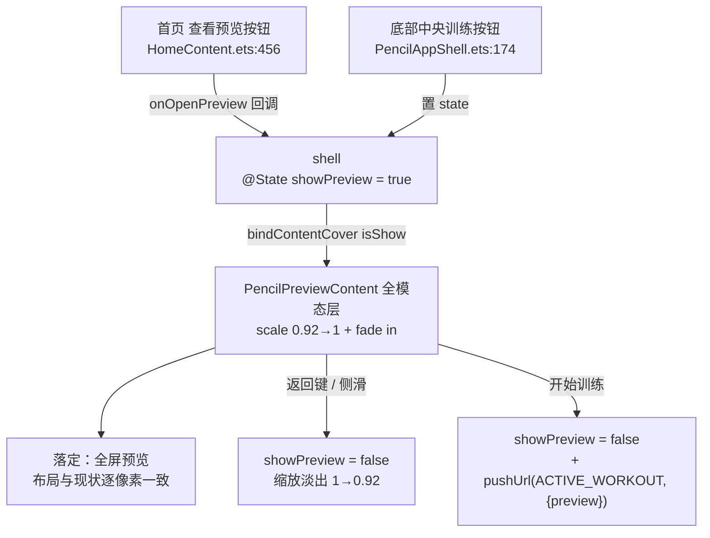

# 训练预览页「缩放弹出」转场设计

Date: 2026-09-28
Status: Draft for review

## Decision Summary

把「训练预览页」（原 `PencilPreviewPage`，一个 `@Entry` 路由页）改造为挂在 app 外壳上的**全模态弹出层**（`bindContentCover`），呈现方式为**从中心缩放弹出**：从 `scale 0.92 + opacity 0` 放大淡入到 `1.0`，关闭时反向。底层 shell 保持不动、由系统模态遮罩自动压暗。

不采用「给路由页加 `pageTransition`」的替代方案——`pageTransition` 只描述本页转场，被压栈的 shell 会按系统默认转场各演各的，且 280ms 转场在模拟器上无法逐帧核验（`docs/motion-restore-workflow.md` §9），行为不可预测。

## 背景与现状

训练预览页当前是独立路由页，两个入口都走系统默认整屏转场：

- `entry/src/main/ets/app/PencilAppShell.ets:174` —— 底部中央训练按钮 `router.pushUrl({ url: AppRoutes.WORKOUT_PREVIEW })`
- `entry/src/main/ets/features/pencil/components/HomeContent.ets:456` —— 首页主卡按钮，同样 `pushUrl(WORKOUT_PREVIEW)`
- `entry/src/main/ets/app/AppRoutes.ets:18` —— `WORKOUT_PREVIEW = 'features/pencil/pages/PencilPreviewPage'`
- `entry/src/main/resources/base/profile/main_pages.json` —— 第 13 项注册 `features/pencil/pages/PencilPreviewPage`

全仓**没有任何** `bindContentCover` / `bindSheet` / `Navigation` / `pageTransition` 用法，页面转场一律为系统默认。

预览页内部会在 `aboutToAppear` 中调用 `resolveTopInset()` 取 `getWindowAvoidArea(TYPE_SYSTEM).topRect.height`，顶栏 `padding-top` 取 `Math.max(56 - topInsetVp, 0)`（因设备页面区落在状态栏之下，须从原型 56vp 中扣掉状态栏高度）。**此布局逻辑必须保持不变。**

## 目标 / 非目标

目标：

- 进入预览页时呈现「缩放弹出」观感：`0.92 → 1.0` 缩放 + 淡入，约 280ms。
- 底层 shell 保留可见并由模态遮罩压暗，符合「像 iOS 模态框」的语义。
- 预览页内部布局、文案、尺寸、数据加载逻辑**一行不改**。

非目标：

- 不改动其他页面（设置、计划组、身体数据等）的转场行为。
- 不引入 `Navigation` 架构重构。
- 不改动「开始训练」的数据传递契约（仍把 `pendingPreview` 带给训练执行页）。

## 架构与数据流



数据流不变：预览数据仍由 `PencilPreviewContent.aboutToAppear` 内的 `loadPreview()` 读取（`TrainingPlanService.getCurrentPlan` → `WorkoutPreviewService`，无当前计划时回落 `GoalRepository.loadGoal` + `PlanEngine.generatePlan`），结果存入内部 `pendingPreview`。「开始训练」把 `pendingPreview` 作为 `params.preview` 传给训练执行页。

## 组件与职责

| 单元 | 职责 | 依赖 |
|---|---|---|
| `PencilPreviewContent`（由 `PencilPreviewPage` 改造） | 渲染预览内容、加载预览数据、持有 `pendingPreview`；对外暴露 `onRequestClose: () => void` 用于关闭 | 复用现有一切服务，无新增依赖 |
| `PencilAppShell` | 持有 `@State showPreview`；挂载 `bindContentCover` 承载模态内容；向 `HomeContent` 传入 `onOpenPreview` 回调；训练按钮改为置 `showPreview = true` | `MotionTokens` |
| `HomeContent` | 「查看预览」按钮由直接 `pushUrl` 改为调用新增的 `onOpenPreview` 回调 | — |
| `AppRoutes` / `main_pages.json` | 移除 `WORKOUT_PREVIEW` 注册（预览页不再是路由页） | — |

## 转场参数

挂在 shell 根组件上的全模态：

```ts
.bindContentCover(
  this.showPreview,
  () => { this.previewCover() },
  {
    // 自定义转场：中心缩放 .92→1 + 淡入；关闭时反向
    transition: TransitionEffect.scale({
        x: MotionTokens.MODAL_POP_SCALE,
        y: MotionTokens.MODAL_POP_SCALE
      })
      .combine(TransitionEffect.opacity(0))
      .animation({ duration: 280, curve: MotionTokens.EASE_PANEL }),
    // true = 内容避开系统安全区，页面区仍落在状态栏之下，
    // 使预览页现有 56 - topInsetVp 的顶栏计算继续成立
    enableSafeArea: true
  }
)
```

- `duration: 280` 与 `MotionTokens.EASE_PANEL`（`cubic-bezier(.32,.72,.3,1)`）复用仓内既有弹层语汇（原型 `.lib-sheet-card` 规格），不新增魔法值；新增 `MotionTokens.MODAL_POP_SCALE = 0.92` 一个常量。
- 缩放中心默认为模态中心（`50%`），符合「从中心弹出」。

### API 依据（本机 SDK 类型声明，非推断）

- `ContentCoverOptions.transition?: TransitionEffect`（since 12）—— `.../ets/component/common.d.ts:15110`
- `ContentCoverOptions.enableSafeArea?: boolean`（since 20）—— `common.d.ts:15121`
- `ContentCoverOptions.modalTransition?: ModalTransition`（默认 `DEFAULT`）—— `common.d.ts:15090`
- `TransitionEffect.scale(ScaleOptions)` / `.combine()` / `.opacity()` / `.animation()` —— `common.d.ts:7443 / 7593 / 7477 / 7571`
- 本仓 `compatibleSdkVersion: '6.0.2(22)'`（`build-profile.json5:23`），上述 API 全部可用。

## 边界与错误处理

- **返回**：预览页内的返回按钮与系统侧滑/返回键都走「关闭模态」（`showPreview = false`），不再调用 `router.back()`；用 `onWillDismiss` 保证系统手势关闭时状态同步。
- **开始训练**：点击后在同一次交互里先置 `showPreview = false`（触发缩放淡出）再 `pushUrl(ACTIVE_WORKOUT, { preview })`，避免模态层残留盖住训练执行页；`pendingPreview` 为空时按现状仅 `pushUrl` 不带参。
- **数据加载失败**：`loadPreview()` 原有 try/catch 与空态文案（`暂时无法读取训练目标…` / `尚未设置训练目标…` / `今天没有训练安排…`）保持不变。
- **重复触发**：`showPreview` 已为 `true` 时再次点击入口不重复打开（幂等）。

## 受影响文件

- 改：`entry/src/main/ets/features/pencil/pages/PencilPreviewPage.ets`（去 `@Entry` → 组件 `PencilPreviewContent`）
- 改：`entry/src/main/ets/app/PencilAppShell.ets`（`@State showPreview` + `bindContentCover` + 训练按钮）
- 改：`entry/src/main/ets/features/pencil/components/HomeContent.ets`（入口改回调）
- 改：`entry/src/main/ets/app/AppRoutes.ets`（移除 `WORKOUT_PREVIEW`）
- 改：`entry/src/main/resources/base/profile/main_pages.json`（移除预览页注册）
- 改：`entry/src/main/ets/common/styles/DesignTokens.ets`（新增 `MODAL_POP_SCALE`）

## 测试与验证策略

本改动是纯 UI 转场，无独立业务逻辑分支，验证分两层：

1. **编译门禁**：`devecocli build --modules entry@default --build-mode debug` 必须 `BUILD SUCCESSFUL`；`node tools/check-gates.mjs` 通过。这是主要自动化证据。
2. **设备视觉验证**（非 mock 的真实路径）：
   - 装 HAP → `aa start --ps devSeed today_flow` 落首页 → 点击「查看预览」→ 截图确认预览页渲染正常、顶栏位置与改动前一致（复用既有 `topInset` 断言值：与 `BodyDataPage`/`SettingsPage` 同口径）。
   - `screenrecord` 录制进入/退出过程，确认 `0.92 → 1.0` 缩放弹出观感与底层压暗。
   - 从预览页点「开始训练」，确认能正常落到训练执行页且动作名正确（`pendingPreview` 传参未因改造丢失）。

上述设备步骤若当前无可用模拟器/设备，则显式标注「未在真实设备验证」，不假装通过。

## 风险与未决

- **模态与路由页层级**：预览模态打开时 `pushUrl(ACTIVE_WORKOUT)` 的层级关系需设备实测；采用「先关模态再跳转」规避。
- **安全区行为**：`enableSafeArea: true` 是否能让模态内容区精确等同于原路由页页面区，需设备截图比对；若不符，改用按安全区显式补 padding，保持顶栏 56vp 观感不变。
- **遮罩浓度**：`bindContentCover` 的遮罩为系统默认，不额外定制；深色主题（页面底 `#0B0F13`）下遮罩差异微弱，符合预期。

## 反证 / 复现

- 现状复现（RED 基线）：改动前，从首页点「查看预览」进入预览页，转场为系统默认（非缩放弹出）——以此作为「改动前的行为证据」，改动后同路径应变为缩放弹出。
- 若 `enableSafeArea: true` 后顶栏位置与改动前不一致（设备实测偏差 > 1px），即为设计假设被推翻，按「风险与未决」第二条回退处理。
- 若模态内 `pushUrl` 被模态层遮挡导致训练执行页不可见，即为边界处理失效，证明「先关模态」策略必要且需确认生效。
