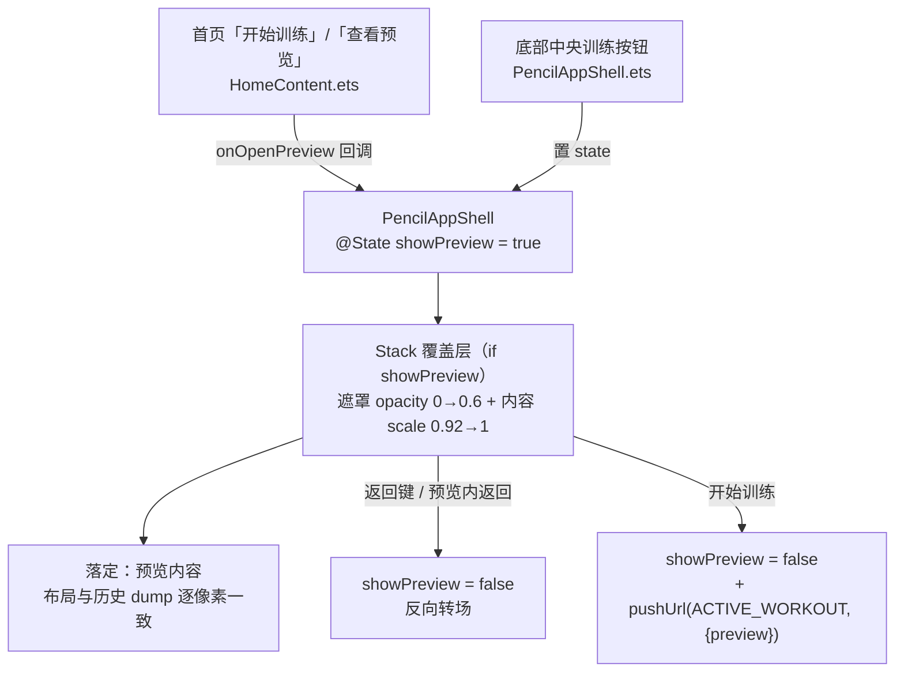

# 训练预览页「缩放弹出」转场设计

Date: 2026-09-28
Status: Implemented · 设备已验证

## Decision Summary

把「训练预览页」（原 `PencilPreviewPage`，一个 `@Entry` 路由页）改造为挂在 app 外壳（`PencilAppShell`）内的**覆盖层**，呈现方式为**从中心缩放弹出**：内容从 `scale 0.92 + opacity 0` 放大淡入到 `1.0`，遮罩从透明淡入到 60% 黑；关闭时反向。

**实现载体由 `bindContentCover` 改判为壳内覆盖层**——设计阶段首选 ArkUI 全模态，设备实测发现其在本 SDK 下不可用（见「关键设备发现」），故改为覆盖层：与仓内其余内容组件走同一套状态传播路径，转场由 `TransitionEffect` 声明式控制。

不采用「给路由页加 `pageTransition`」的方案——`pageTransition` 只描述本页转场，被压栈的 shell 会按系统默认转场各演各的。

## 背景与现状

训练预览页原为独立路由页，两个入口都走系统默认整屏转场：

- `entry/src/main/ets/app/PencilAppShell.ets` —— 底部中央训练按钮
- `entry/src/main/ets/features/pencil/components/HomeContent.ets` —— 首页主卡「开始训练」与「查看预览」两个按钮

`HomeContent` 还有第二个消费方 `PencilHomePage.ets`（`aboutToAppear` 立即 `replaceUrl` 到 AppShell 的薄壳，用户无法与其交互）。

`AppRoutes.WORKOUT_PREVIEW` 另被 `HomePlanService.ets:123/199`（`startRoute` 字段）与 `TargetLoopFlow.test.ets:103` 断言引用。

预览页顶栏沿用既有口径：`resolveTopInset()` 取 `getWindowAvoidArea(TYPE_SYSTEM).topRect`，`padding-top = Math.max(56 - topInsetVp, 0)`。**该逻辑未改动。**

## 目标 / 非目标

目标：

- 进入预览页时呈现「缩放弹出」：`0.92 → 1.0` 缩放 + 淡入，200ms。
- 底层 shell 保持可见并由遮罩压暗。
- 预览页内部布局、文案、尺寸、数据加载逻辑保持不变。

非目标：

- 不改动其他页面的转场行为。
- 不引入 `Navigation` 架构重构。
- 不改动 `HomePlanService.startRoute` 的取值与相关测试断言。

## 架构与数据流



数据流不变：预览数据由 `PencilPreviewContent.aboutToAppear → loadPreview()` 读取，结果存入内部 state。「开始训练」把 `pendingPreview` 作为 `params.preview` 传给训练执行页。

## 组件与职责

| 单元 | 职责 | 依赖 |
|---|---|---|
| `PencilPreviewContent`（由 `PencilPreviewPage` 改造，文件路径暂沿用） | 渲染预览内容、加载预览数据、持有 `pendingPreview`；对外暴露 `onRequestClose: () => void` | 复用现有一切服务 |
| `PencilAppShell` | 持有 `@State showPreview`；以 `Stack` + `if` 承载覆盖层与遮罩；`onBackPress` 接管返回；向 `HomeContent` 传 `onOpenPreview` | `MotionTokens` |
| `HomeContent` | 两处按钮由直接 `pushUrl` 改为调用可选回调 `onOpenPreview`（`PencilHomePage` 薄壳不注入） | — |
| `main_pages.json` | 移除预览页注册（不再是路由页） | — |
| `AppRoutes` | **保留** `WORKOUT_PREVIEW` 常量并加注（仍被 `HomePlanService` 与测试引用，无生产代码据此 `pushUrl`） | — |

## 转场参数（as-built）

```ts
if (this.showPreview) {
  // 遮罩：淡入到 60% 黑
  Column().width('100%').height('100%').backgroundColor('#000000').opacity(0.6)
    .transition(TransitionEffect.OPACITY.animation({
      duration: MotionTokens.DURATION_MODAL_SCRIM,   // 160
      curve: MotionTokens.EASE_MOTION
    }))

  // 内容：中心缩放弹出
  Column() { PencilPreviewContent({ onRequestClose: () => { this.showPreview = false } }) }
    .width('100%').height('100%')
    .transition(
      TransitionEffect.scale({ x: MotionTokens.MODAL_POP_SCALE, y: MotionTokens.MODAL_POP_SCALE }) // 0.92
        .combine(TransitionEffect.OPACITY)
        .animation({ duration: MotionTokens.DURATION_MODAL_POP, curve: MotionTokens.EASE_PANEL })   // 200
    )
}
```

`MotionTokens` 新增 `MODAL_POP_SCALE = 0.92`、`DURATION_MODAL_POP = 200`、`DURATION_MODAL_SCRIM = 160`。

**时长为何不复用共享 token**：`DURATION_PANEL`(280) 与 `DURATION_OVERLAY`(220) 是 sheet 面板语汇，动作库与身体数据的 sheet 转场也在用；改值会连带改掉它们。首版据此取值后体感偏长，故单独取值——弹出转场比 sheet 更短更利落。

## 关键设备发现（决定实现载体）

1. **`bindContentCover` 的第二参数必须传 `@Builder` 的调用态**（`this.previewCover()`）。传箭头包装 `() => { this.previewCover() }` 时模态**完全不出现**（点击事件已到达 Button、状态已置真，但无任何模态节点，日志无报错）。
2. 改用调用态后模态出现，但**内容被固化为快照**：`PencilPreviewContent.aboutToAppear` 内的异步加载已把 `items` 置为 5（探针实测），界面却始终停在初始态（`Day 01`/`训练预览`/`暂无训练动作`）——该子树不随子组件状态重渲染。
3. 因此改用壳内覆盖层 + `TransitionEffect`，状态传播与仓内其余组件一致，问题消失。

## 边界与错误处理

- **返回**：预览内返回按钮与系统返回键都走 `showPreview = false`（shell 的 `onBackPress` 返回 `true` 拦截）。
- **开始训练**：先置 `showPreview = false` 再 `pushUrl(ACTIVE_WORKOUT, { preview })`，避免覆盖层残留盖住执行页。
- **数据加载失败**：`loadPreview()` 原有 try/catch 与空态文案保持不变。
- **重复触发**：`if (this.showPreview)` 保证幂等。

## 受影响文件

- `entry/src/main/ets/features/pencil/pages/PencilPreviewPage.ets`（去 `@Entry`，更名 `PencilPreviewContent`，加 `onRequestClose`，返回改回调，开始训练先关闭）
- `entry/src/main/ets/app/PencilAppShell.ets`（覆盖层 + 遮罩 + `onBackPress` + 两处入口改置 state）
- `entry/src/main/ets/features/pencil/components/HomeContent.ets`（可选 `onOpenPreview` 回调，替换两处 `pushUrl`；移除已无用的 `AppRoutes` import）
- `entry/src/main/ets/app/AppRoutes.ets`（保留常量 + 加注）
- `entry/src/main/resources/base/profile/main_pages.json`（移除预览页注册）
- `entry/src/main/ets/common/styles/DesignTokens.ets`（新增 `MODAL_POP_SCALE`）

## 验证证据

自动化门禁（`node tools/check-gates.mjs`，exit 0）：

```
[build-gates] content build passed
[build-gates] main page check passed
[build-gates] git whitespace/style passed
[build-gates] doc dead-refs passed
[build-gates] ArkTS 编译门禁：devecocli 1.3.4
[build-gates] ArkTS 编译通过
```

设备验证（模拟器 127.0.0.1:5555，1320×2856）：

- **入口可达**：首页点「查看预览」（Button 中心 660,1660）→ 覆盖层弹出，`uitest dumpLayout` 出现 `训练预览`、`Day 01`、`主动作`、`杠铃平板卧推`、`哑铃推举`、`确认动作与重量后开始训练`。
- **数据正确**：动作条目渲染为 5 条（空态文案 `暂无训练动作` 为 0 次命中）。
- **布局无漂移**：顶栏标题 `[250,229][1111,298]` 与历史 dump 逐像素一致；CTA `[60,2502][1260,2678]` 与历史 dump 的主流值（`layout-pv-after/pv2/pv3.json`）**完全一致**。
- **链路闭合**：覆盖层内点「开始训练」→ 成功落到训练执行页并带上动作数据（页面显示「杠铃平板卧推」）。
- **动画生效**：将转场时长临时放大到 2000ms 后连拍 5 帧，CTA 绿色包围盒宽度为 1086 → … → 1190（满宽 1198），首帧 ≈0.906 倍（起始 0.92）、随后单调收敛到 1.0——若 `TransitionEffect` 未生效，首帧即应为满宽。
- **时长缩短可测**：同一连拍法下，280ms 版首帧宽 1086（需 4~5 帧落定），200ms 版首帧宽 1172、第 2 帧即达满宽 1198——转场确实变短。

## 风险与未决

- **退出动画未单独取证**：关闭方向复用同一 `TransitionEffect`（`if` 移除节点触发），机制与进入一致，但未逐帧单独验证。
- **预览页文件路径未整理**：`pages/PencilPreviewPage.ets` 内现为 `PencilPreviewContent`，路径与命名略不符（改名涉删/移文件，未纳入本次范围）。
- **`WORKOUT_PREVIEW` 常量为悬空标识**：其值指向已移除注册的路由路径，仅作 `HomePlanService.startRoute` 与测试的标识使用，无生产 `pushUrl` 消费。

## 反证 / 复现

- 改动前从首页点「查看预览」为系统默认整屏转场；改动后同路径为 0.92→1 缩放 + 遮罩淡入。
- 假设「`bindContentCover` 可用」已被设备实测推翻（模态不出现 / 内容固化），故实现改判为覆盖层。
- 复现：`hdc install -r entry/build/default/outputs/default/entry-default-signed.hap` → `aa start -a EntryAbility -b com.earthrhythm.fittracker --ps devSeed today_flow` → 点击 (660,1660) → `uitest dumpLayout` 校验 `训练预览` 与动作条目。
