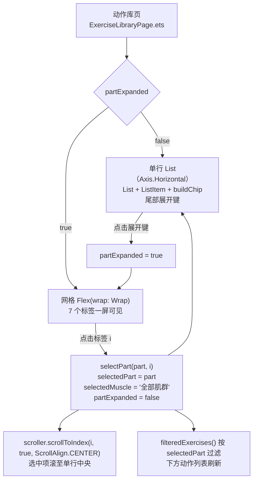

# 动作库分类标签展开面板（Expandable Tabs）设计

> 日期：2026-10-16
> 范围：`apps\harmony\entry\src\main\ets\features\exercise\pages\ExerciseLibraryPage.ets`（单文件）
> 状态：待审批

## 需求提炼

用户原话：给动作库页做一个分类标签展开面板（Expandable Tabs），单行展开为网格，选中后收回并居中。

目标：

- 部位分类标签（`PART_OPTIONS`，7 项）默认呈**单行**横向排布。
- 单行尾部提供展开键；点击后该行**展开为网格**，全部 7 个标签一屏可见。
- 在网格中点选某标签后，面板**收回为单行**，并把该选中标签**滚动至单行中央**。
- 单行态保留横向滚动能力（不因改动丢失访问全部标签的路径）。
- 筛选语义不变：选中部位后下方动作列表仍按 `selectedPart` 过滤。

非目标：

- 不改肌群行（`buildMuscleChips`）的形态——本次仅部位行。
- 不改数据源。页面内硬编码 `EXERCISES`（23 条）与 `ExerciseService`／`LocalExerciseContent`（102 条）的分叉**不在本次范围**，仅记录。
- 不改路由、`main_pages.json`、`AppRoutes`。
- 不引入新组件文件，改动留在页面内（遵循 Pencil 主线「feature 内集中声明」约定）。

## 落点与现状

| 位置 | 现状 |
|---|---|
| `ExerciseLibraryPage.ets:116` | `PART_OPTIONS: string[] = ['全部','胸部','背部','肩部','手臂','腿部','核心']` |
| `ExerciseLibraryPage.ets:147` | `@State private selectedPart: string = '全部'` |
| `ExerciseLibraryPage.ets:306-309` | `selectPart(part)` —— 设 `selectedPart`，并把 `selectedMuscle` 重置为 `'全部肌群'` |
| `ExerciseLibraryPage.ets:596-607` | `buildChip(label, active)` —— 胶囊标签，选中态用 `LibPalette.CHIP_*` |
| `ExerciseLibraryPage.ets:622-639` | `buildPartChips()` —— `Scroll` + `Row(space:8)` + `ForEach`，`.scrollable(ScrollDirection.Horizontal)` |
| `ExerciseLibraryPage.ets:641-658` | `buildMuscleChips()` —— 同理，仅当 `selectedPart !== '全部'` 时渲染（`:403`） |
| `ExerciseLibraryPage.ets:956` | `Flex({ wrap: FlexWrap.Wrap })` —— 项目既有网格写法，本次沿用 |

**技术前提（已用本地 SDK 类型定义核验）**：

| 事实 | 证据 |
|---|---|
| `Scroller.scrollToIndex(value, smooth?, align?, options?)` 存在 | `scroll.d.ts:703` |
| 该方法**仅对 ArcList／Grid／List／WaterFlow 生效** | `scroll.d.ts:680`（`NOTE: This API only works for the ArcList, Grid, List, and WaterFlow components`，属 `@since 12` 版本） |
| `ScrollAlign.CENTER` 存在（值 1） | `scroll.d.ts:183` |
| API 版本满足 | `apps\harmony\build-profile.json5:24-25`（`targetSdkVersion: '6.0.2(22)'`），`scrollToIndex` `@since 12` |

**方案修正记录**：初版方案主张「`Scroll` + `scroller.scrollToIndex(..., ScrollAlign.CENTER)` 实现居中」。该主张经 SDK 证据推翻——`scrollToIndex` 对 `Scroll` 组件不生效（仅 List／Grid／WaterFlow／ArcList）。单行态因此改用横向 `List`。此修正使实现从「依赖未定义行为」变为「依赖官方支持路径」。

## 架构与数据流

数据流不变：筛选仍由 `matchesFilters()`（`:255`）→ `filteredExercises()`（`:278`）驱动，本次不触碰。新增的仅是「面板形态」这一纯 UI 状态。

## 交互状态机

| 起始态 | 动作 | 结束态 | 副作用 |
|---|---|---|---|
| 单行 | 点击展开键 | 网格 | `partExpanded = true` |
| 网格 | 点击标签 i | 单行 | `selectPart(part, i)` → 收回 + 居中 + 重置肌群 + 列表过滤 |
| 网格 | 点击展开键 | 单行 | `partExpanded = false`（不滚动，无选中变更） |
| 单行 | 横向滑动 | 单行 | 原生滚动，无状态变更 |

## 组件与职责

| 单元 | 职责 | 依赖 |
|---|---|---|
| `buildPartChips()`（改造） | 按 `partExpanded` 分派单行／网格两种形态 | `buildChip()`、`LibPalette`、`MotionTokens` |
| `buildPartRow()`（新增，私有 `@Builder`） | 单行态：横向 `List` + `ListItem` + 尾部展开键 | `this.partScroller` |
| `buildPartGrid()`（新增，私有 `@Builder`） | 展开态：`Flex({ wrap: FlexWrap.Wrap })` 承载 7 个标签 | `buildChip()` |
| `selectPart(part, index)`（改签名） | 收回 + 重置肌群 + 居中滚动 | `this.partScroller`、`ScrollAlign` |
| `this.partScroller`（新增私有字段） | `Scroller` 实例，供居中调用 | — |
| `@State partExpanded`（新增） | 面板形态开关 | — |

`buildChip()`、`buildSmallChip()`、`LibPalette`、筛选逻辑**一律不动**。

## 反证/复现

设计中的三条主张，各自的证伪路径：

1. **「`scrollToIndex` 可用于本页的居中」**
   证伪：若 SDK 类型定义不含该方法，或范围注释不含 `List` → 主张不成立。
   已核验：`scroll.d.ts:703` 有签名，`:680` 范围含 `List`。**未被证伪。**
   残留风险：类型存在 ≠ 运行时生效于横向 List。**须真机／模拟器实测**，未实测前该条标记为「未验证」。

2. **「状态变更后同步调用 `scrollToIndex` 即可居中」**
   证伪：若收回当帧布局未落定，居中不生效（表现：面板已收回但视图停在原位）。
   处置：实现时先试同步调用，不生效则退到下一帧（候选见下）。**此项必须实测确认**，不接受推断。

3. **「改造不破坏既有横向滚动能力」**
   证伪：若单行态滚不到末位标签 → 原能力回退。
   处置：验收面第 3 条（横向滚动可访问全部标签）为显式判据。

## 待实测确认的开放项

以下两项**不写死**，实现后以实测结果落定：

1. **居中调用时机**：候选 (a) 状态变更后同步调用；(b) 延迟一帧调用。取实测生效者。
2. **单行 List 高度**：横向 `List` 需显式高度（不设高度行为不确定）。chip 实测高约 34vp（`fontSize 13` + `padding 8/8` + `1vp` 边框），初值取 `36`，实测后校准。

## 验证计划

| 命令 | 位置 | 期望 |
|---|---|---|
| `node tools/check-main-pages.mjs` | `apps\harmony` | exit 0（本次未增删页面，应无变化） |
| `node tools/check-gates.mjs` | `apps\harmony` | exit 0 |
| `devecocli build --product default` | `apps\harmony` | `BUILD SUCCESSFUL` |

设备／模拟器验收（无设备时必须标注「未在真实环境验证」）：

1. 点击展开键 → 面板由单行变网格，7 个标签全部可见。
2. 点击网格中「腿部」→ 面板收回为单行，「腿部」为选中态且水平居中，下方列表只剩腿部动作。
3. 单行态横向滑动 → 可访问到最末的「核心」标签。

## 已知不处理项（记录，不夹带）

动作库页数据源已分叉：页面内硬编码 23 条 `EXERCISES`（`:100-114`），而提交 `baf394b` 把动作库扩充到 102 条的改动落在 `ExerciseService`／`LocalExerciseContent`，页面从不消费后者。本次筛选做对后筛的仍是旧 23 条。**是否接新数据源另议，不在本次改动内。**
